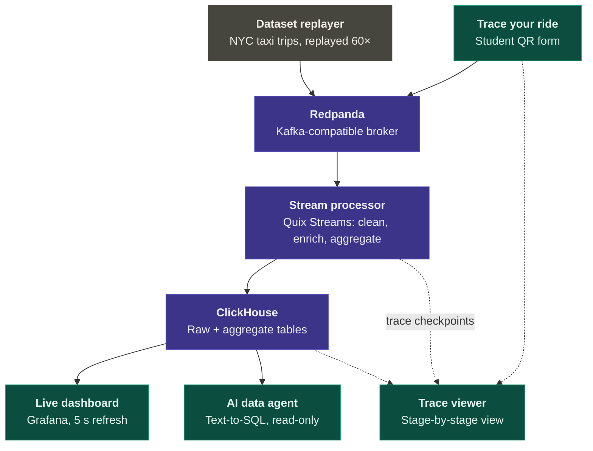

# Architecture

## 1. Goal and constraints
| Constraint | Consequence |
|---|---|
| Visitors spend 2–3 minutes | Everything visible and instant. No login, no install, first answer within 15 s |
| One macOS laptop, 32 GB | Single-node everything, Docker Compose, native Ollama for the GPU |
| Venue network is unknown | Offline-first. Own travel router. Only the optional internal AI needs internet |
| Public stand, curious students | Read-only agent, strict limits, no visitor free text shown to others |
| Built in 2–3 weeks | Python where possible, boring tech, explicit cut lines |
| It's a teaching demo | Transparency over magic: show SQL, show stages, show rejected data |

## 2. Component overview

| Component | Tech | Responsibility | Spec |
|---|---|---|---|
| Data prep | DuckDB + geopandas (one-off) | Download, sort, filter, compute zone centroids | [01](specs/01-data-and-replayer.md) |
| Replayer | Python, confluent-kafka | Publish trips in sim-time order at N×, publish sim clock, pause/resume | [01](specs/01-data-and-replayer.md) |
| Broker | Redpanda (single node) + Redpanda Console | Durable log, decouples every stage, visible topics for the demo | [02](specs/02-topics-and-event-contracts.md) |
| Stream processor | Quix Streams | Validate → enrich → window → sink. Emit trace checkpoints | [03](specs/03-stream-processor.md) |
| Storage | ClickHouse (single node) | Enriched trips, rejects, aggregates, traces, agent log | [04](specs/04-clickhouse-schema.md) |
| Dashboard | Grafana + ClickHouse datasource | Live city view and stand-health view | [05](specs/05-grafana-dashboards.md) |
| AI agent | FastAPI + openai SDK → Ollama / internal gateway | Text-to-SQL with tools, guardrails, SSE | [06](specs/06-ai-data-agent.md) |
| Trace your ride | FastAPI (rides + WS relay) + processor checkpoints | Student ride creation and live stage tracking | [07](specs/07-trace-your-ride.md) |
| Web UI | Next.js + TypeScript | /agent, /ride, /trace, /architecture, /qr | [08](specs/08-web-frontend.md) |
| Edge & infra | Caddy, Docker Compose, travel router | Single entry point, networking, resources | [09](specs/09-infrastructure-and-networking.md) |

## 3. Data flow
The full topology is in [DIAGRAMS §2](DIAGRAMS.md#2-topic--data-flow-topology).

1. **Replayer** reads `data/replay/trips_<month>.parquet` (sorted by pickup) and produces each row to `trips.raw` once the sim clock passes its `pickup_ts`. It sends a `sim.clock` heartbeat every second.
2. **Ride API** produces student rides to the same `trips.raw` topic. A ride is timestamped with the current sim clock, so it is indistinguishable from real data downstream except for `source='student'`.
3. **Processor** consumes `trips.raw`:
   - Invalid records → `trips.rejected` and `taxi.trips_rejected`.
   - Valid records → enrich (zone names, derived fields) → `trips.enriched` and `taxi.trips`.
   - Enriched records → 1-minute tumbling windows (sim time) per pickup borough → `agg.borough_minute` and `taxi.agg_borough_minute`.
4. **Trace checkpoints** from API, replayer, and processor land on `trace.checkpoints`. ClickHouse ingests them itself (Kafka engine → `taxi.trace_events`), and the API relays them to browsers over WebSocket.
5. **Grafana** and the **agent** read ClickHouse, each with its own read-only user.

## 4. The two clocks (most important concept)
The dataset is historical. We replay it faster than real time, so there are two clocks:

| | Sim time | Wall time |
|---|---|---|
| What | The moment in the dataset (NYC local) | The real moment at the stand (UTC) |
| Speed | `REPLAY_SPEED`× (default 60: 1 h of data per wall minute) | 1× |
| Column suffix | `*_ts` (`pickup_ts`, `window_start`…) | `*_at` (`produced_at`, `stored_at`…) |
| Source of "now" | `taxi.sim_now` view / `sim.clock` topic | `now64()` |
| Used for | Business questions, windows, dashboards | Pipeline latency, freshness, ops |

Rules:
- ClickHouse server timezone is **UTC**.
- Sim timestamps are stored in `DateTime64(3)` **as naive NYC local values** (they are never converted).
- Grafana dashboards set timezone = UTC, so they display sim times exactly as they appear in the data.
- The replayer loops at end of file with `+REPLAY_LOOP_OFFSET_DAYS` (35 = 5 weeks). Sim time therefore always moves forward and weekdays line up.

At 60×, one October month (≈3.5 M trips) lasts about 12 wall hours at ~80 msg/s average and ~200 msg/s peak. That's trivial load, which leaves headroom for the backfill at max speed.

## 5. Ports & services
| Service | Container port | Host binding | Exposed to stand LAN |
|---|---|---|---|
| caddy | 80 | `0.0.0.0:80` | **yes (only this)** |
| web (Next.js) | 3000 | `127.0.0.1:3000` | via Caddy `/` |
| api (FastAPI) | 8000 | `127.0.0.1:8000` | via Caddy `/api/*` |
| grafana | 3000 | `127.0.0.1:3001` | via Caddy `/grafana/*` |
| redpanda (Kafka) | 9092 internal / 19092 external | `127.0.0.1:19092` | no |
| redpanda admin | 9644 | `127.0.0.1:9644` | no |
| redpanda-console | 8080 | `127.0.0.1:8080` | no (shown on the laptop screen) |
| clickhouse HTTP / native | 8123 / 9000 | `127.0.0.1:8123` / `127.0.0.1:9000` | no |
| replayer control | 8001 | `127.0.0.1:8001` | no |
| Ollama (native, not Docker) | n/a | `127.0.0.1:11434` | no |

## 6. Resource budget (32 GB laptop)
| Consumer | Budget | How it's enforced |
|---|---|---|
| macOS + screens + browser | ~6 GB | n/a |
| Ollama, 14B Q4 model | ~10 GB | model choice (spec 06) |
| Docker Desktop VM | 14 GB total | Docker Desktop → Resources |
| … redpanda | 1.5 GB | `--memory 1G --smp 1 --reserve-memory 0M --overprovisioned` |
| … clickhouse | 4 GB | `max_server_memory_usage_to_ram_ratio`, and per-profile `max_memory_usage` |
| … grafana, console, caddy | ~0.8 GB | compose `mem_limit` |
| … api, processor, replayer | ~1.5 GB | compose `mem_limit` |
| … web | 0.5 GB | compose `mem_limit` |
| Headroom | ~2 GB | n/a |

Disk: roughly 1 GB for raw and prepared data, and under 3 GB of ClickHouse data after a full event day including backfill. Kafka retention is size-based, 1 GiB per partition (ADR-015).

## 7. Security posture
- **Network:** only Caddy listens on the LAN. Everything else is bound to `127.0.0.1` or the Compose network.
- **ClickHouse users** (spec 04):
  - `ingest_writer`: INSERT only, used by the processor and the api `agent_log` writer.
  - `agent_ro`: SELECT on whitelisted tables, `readonly=1`, hard limits, quota.
  - `grafana_ro`: SELECT on taxi.*.
  - `default`: disabled for network access.
- **Agent:** input length and rate limits, the SQL guard (single SELECT, whitelist, no SETTINGS, forced LIMIT), and a tool-iteration cap (spec 06).
- **Rides:** server-side validation and a rate limit. There are no free-text fields, so there's nothing to moderate.
- **Secrets:** `.env` only, never committed or logged. The internal AI API key is used only by the api container.
- **Privacy:** no accounts, cookies, or personal data. `agent_log` stores question text only, with no IP address.
- **Data policy:** before enabling the internal AI gateway, confirm with IT that sending visitor questions (public, non-personal) to it is allowed.

## 8. Failure isolation
- Each stage is decoupled by Redpanda. Killing any consumer loses nothing: it resumes from committed offsets.
- If the agent dies, the dashboard still works. If ClickHouse restarts, the processor retries the sink and Kafka buffers.
- If the LLM is down, suggested questions still answer from cached SQL on live data (spec 06).
- If the whole laptop dies, fall back to the pre-recorded video and the printed poster (RUNBOOK).

## 9. Versions
Pin these at **M0** (exact tags and versions, never `latest`). Record the chosen version and the date verified.

| Component | Version | Verified on |
|---|---|---|
| Redpanda (`redpandadata/redpanda`) | v26.2.3 | 2026-09-28 |
| Redpanda Console | v3.12.0 | 2026-09-28 |
| ClickHouse (`clickhouse/clickhouse-server`, 26.3 LTS) | 26.3.34 | 2026-09-28 |
| Grafana OSS + `grafana-clickhouse-datasource` | 12.4.3 + 4.21.3 | 2026-09-28 |
| Caddy 2 | 2.11.4-alpine | 2026-09-28 |
| Python / uv | 3.12 / 0.11.13 | 2026-09-28 |
| quixstreams | 3.26.0 | 2026-09-28 |
| confluent-kafka, clickhouse-connect, pyarrow, duckdb | 2.15.1, 1.9.0, 25.0.1, 1.5.5 | 2026-09-28 |
| fastapi, openai, sqlglot | pin at M3 | |
| Node / pnpm / Next.js | pin at M3 | |
| Ollama + chosen model tag | 0.30.8 + TBD after eval (M3) | |

## 10. What we deliberately don't do
- No schema registry, Avro, or Protobuf. JSON plus JSON Schema contracts is more readable on screen ([DECISIONS](DECISIONS.md) ADR-006).
- No Kubernetes, cloud, or multi-node setup. No exactly-once into ClickHouse (ReplacingMergeTree dedups instead).
- No OpenTelemetry/Jaeger. Custom trace checkpoints are more visual for students (ADR-005).
- No authentication for visitors. Admin endpoints use a token.
