# Diagrams

All diagrams are Mermaid, so they render on GitHub, GitLab, VS Code (Markdown Preview Mermaid), and in Grafana text panels. The relevant specs embed the same diagrams. **When a diagram changes, update it here first.**

Colour code (matches the original architecture image):
- **Purple** is the core pipeline.
- **Green** is visitor-facing.
- **Grey** is the data source.
- **Dashed lines** are trace checkpoints.

1. [System architecture](#1-system-architecture)
2. [Topic & data-flow topology](#2-topic--data-flow-topology)
3. [Agent question: sequence](#3-agent-question--sequence)
4. [Trace your ride: sequence](#4-trace-your-ride--sequence)
5. [Trace checkpoint stages: state machine](#5-trace-checkpoint-stages--state-machine)
6. [ClickHouse schema: ER diagram](#6-clickhouse-schema--er-diagram)
7. [Deployment & network](#7-deployment--network)
8. [LLM fallback decision flow](#8-llm-fallback-decision-flow)
9. [Visitor journey at the stand](#9-visitor-journey-at-the-stand)
10. [Timeline (Gantt)](#10-timeline-gantt)
11. [Sim time vs wall time](#11-sim-time-vs-wall-time)
12. [Stream processor dataflow](#12-stream-processor-dataflow)

---

## 1. System architecture

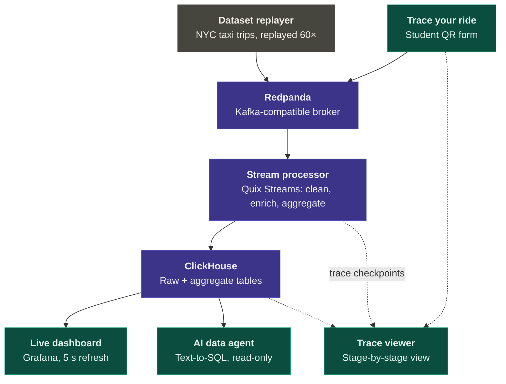

## 2. Topic & data-flow topology

Producers → topics → consumers → tables. `trips.raw` and `trips.enriched` have 1 partition (ordered event time, ADR-014). The others have 3. All use size-based retention of 1 GiB per partition (ADR-015), except `sim.clock`, which is compacted.

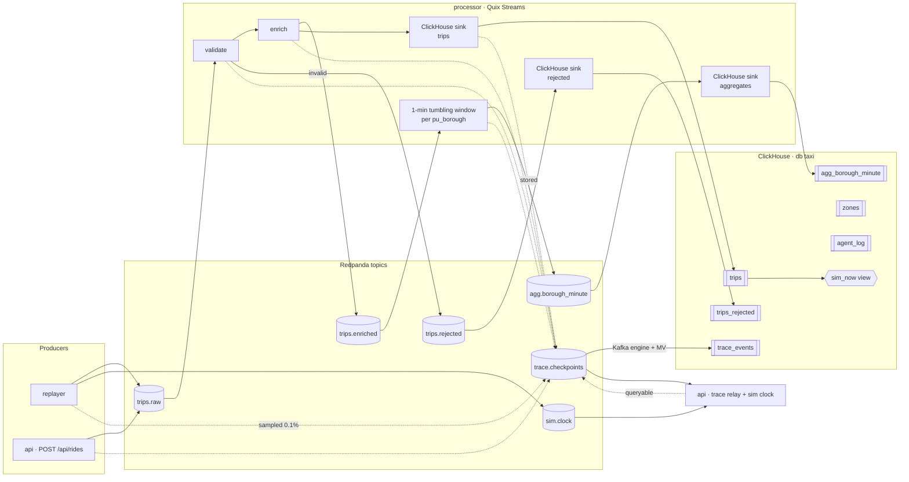

## 3. Agent question: sequence

The API streams every step to the browser as Server-Sent Events, so students see the agent "think".

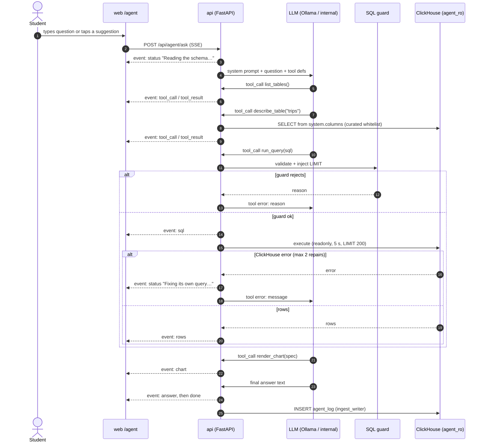

## 4. Trace your ride: sequence

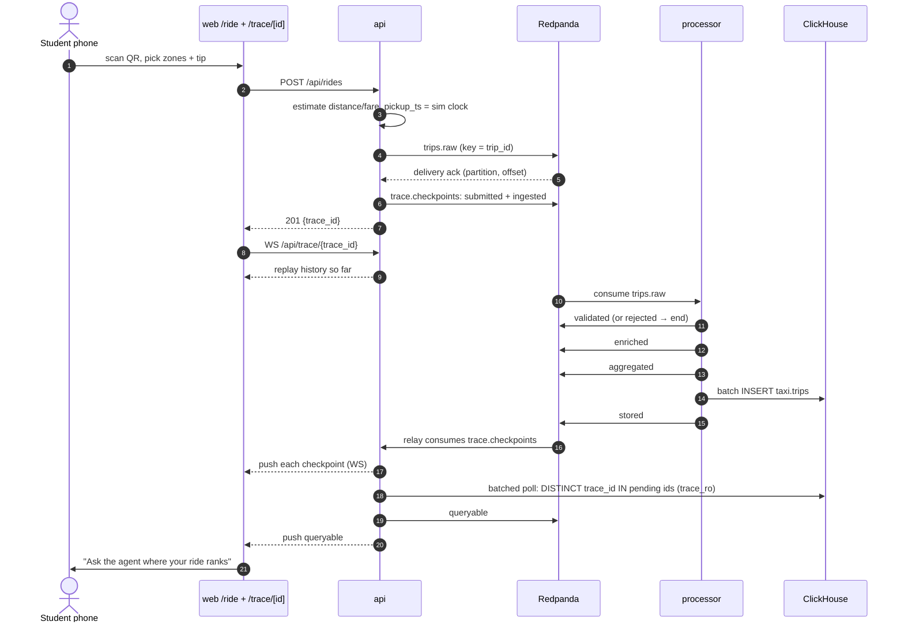

## 5. Trace checkpoint stages: state machine

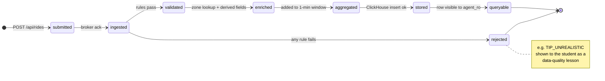

Replay trips sampled for tracing start at `ingested`, emitted by the replayer. They have no `submitted` stage.

## 6. ClickHouse schema: ER diagram

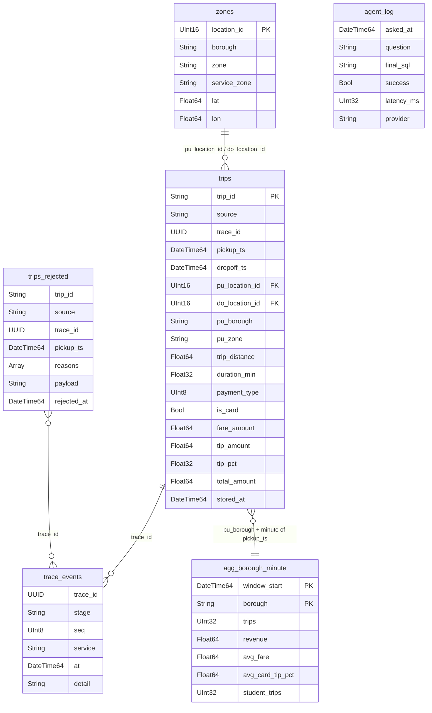

## 7. Deployment & network

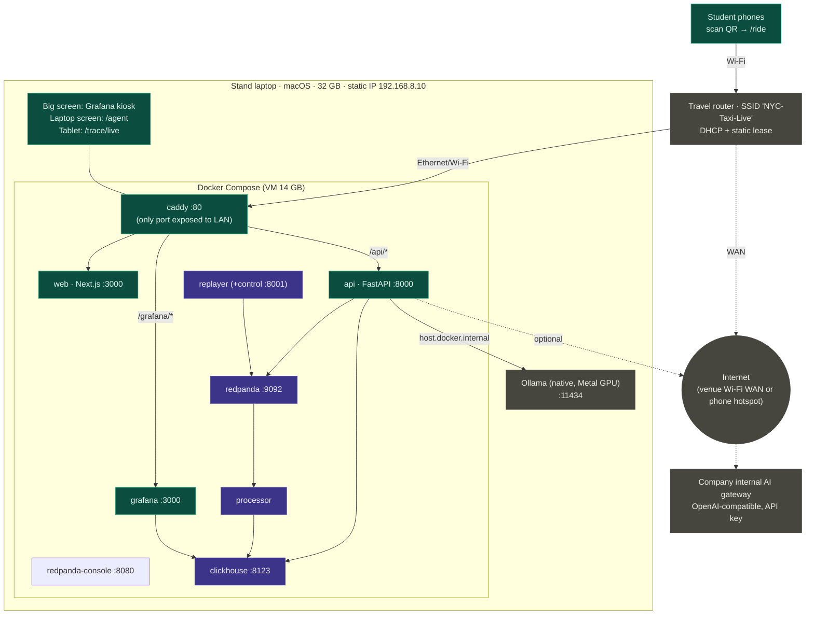

## 8. LLM fallback decision flow

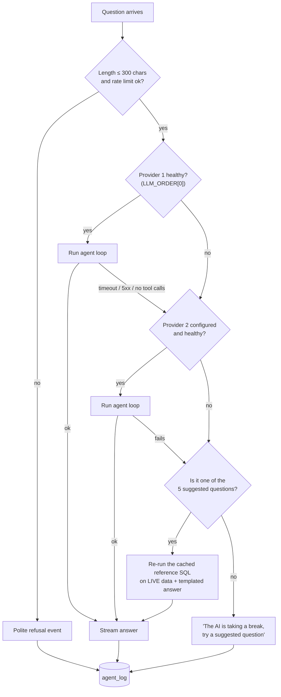

The health check is a background task that calls `GET {base_url}/models` every 15 s. A provider is marked unhealthy after 2 consecutive failures and healthy again after 1 success.

## 9. Visitor journey at the stand

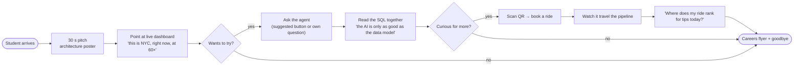

## 10. Timeline (Gantt)

This assumes the event is on **Fri 2026-10-16**. Shift every date if `EVENT_DATE` differs.

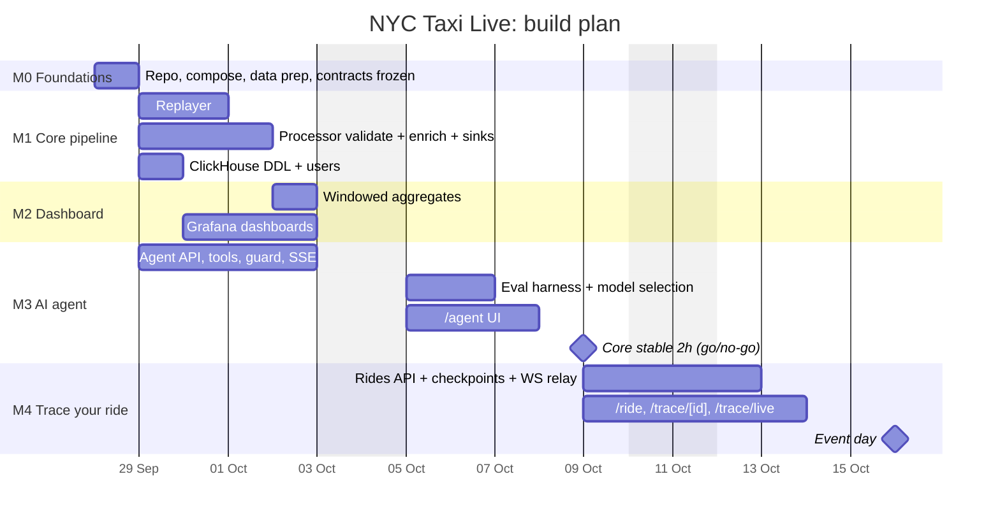

## 11. Sim time vs wall time

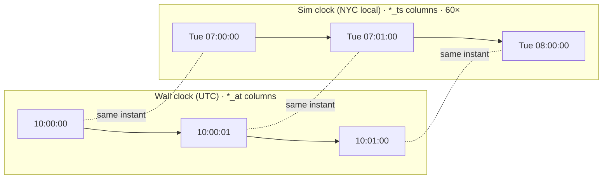

- Business questions ("today", "last hour", "rush hour") use **sim** time via `taxi.sim_now`.
- Pipeline latency ("how long did my ride take to get stored?") uses **wall** time only.

## 12. Stream processor dataflow

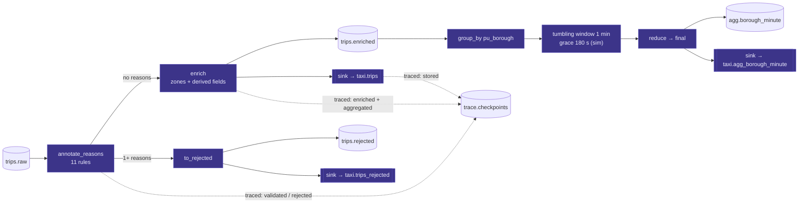
