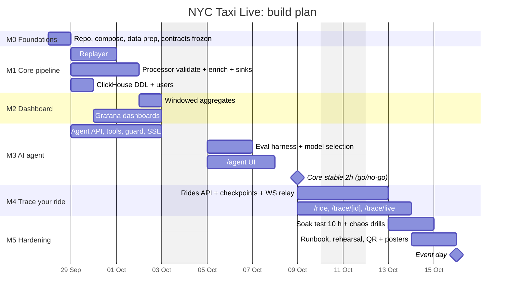

# Implementation Plan

**Event date:** `EVENT_DATE = 2026-10-16` (Fri). **This is a placeholder.** If the date differs, shift every date below. The structure stays the same.

**Start:** Mon 2026-09-28. There are **14 build days** (D1–D14), with D15 as the event day.

**Team assumption:** 1–3 people. The work splits into three parallel workstreams. A single developer does them in the order listed, which is also the priority order.

| Workstream | Owns | Specs |
|---|---|---|
| **A: Pipeline** | data prep, replayer, Redpanda, processor, ClickHouse | 01, 02, 03, 04 |
| **B: Agent** | api (agent, guard, LLM chain), evals, rides API, trace relay | 06, 07, 10 (evals) |
| **C: Visitor UX** | Grafana, Next.js pages, Caddy, networking, printed material | 05, 08, 09 |

<!-- diagrams:begin -->
## Diagrams
*Copied from [DIAGRAMS.md](DIAGRAMS.md). Edit there, then run `make diagrams-sync`.*

**§10 Timeline (Gantt)**

<!-- diagrams:end -->

---

## Milestones

### M0: Foundations (D1 · Mon 28 Sep)
**Goal:** everyone can `make up` an empty but healthy stack. Contracts are frozen.
- [x] Repo skeleton per CLAUDE.md repo map. Git init, `.gitignore` (`data/`, `.env`, `node_modules`, `.venv`).
- [x] `docker-compose.yml` with redpanda, redpanda-console, clickhouse, grafana, caddy, all with healthchecks (spec 09).
- [x] `infra/redpanda/create-topics.sh` creates the 6 topics (spec 02).
- [x] `scripts/prepare_data.py` + `make data`. **Verify** that `TLC_MONTH=2025-10` is downloadable and inspect its columns. Pick `REPLAY_START_TS` (a busy Tue 07:00) (spec 01).
- [x] Pin every version in ARCHITECTURE §9.
- [ ] Install Ollama natively and pull 2–3 candidate models (spec 06 §Model selection).
- [ ] Ask IT about the internal AI gateway: base URL, key, model name, and data policy.
- [ ] Order or borrow: travel router, HDMI screen or TV, tablet, extension cord.

**Exit:** `make data && make up` is green. `rpk topic list` shows the 6 topics. Parquet and `zones.csv` exist.

### M1: Core pipeline (D2–D4)
- [x] **A** ClickHouse DDL + users/profiles (`infra/clickhouse/init/*.sql`, `users.d/*.xml`) and the zones loader (spec 04).
- [x] **A** Replayer: pacing with a fake-clock unit test, producer, `sim.clock`, state file, control API, backfill mode (spec 01).
- [x] **A** Processor: validation rules (TDD), enrichment (TDD), branching, ClickHouse sinks for trips and rejects (spec 03).
- [x] **B** *(moved to the M3 plan)* Start the api skeleton in parallel: FastAPI app, config, ClickHouse clients, `/api/healthz`, `/api/zones`, `/api/sim/clock`.

**Exit:** at 60×, `SELECT count() FROM taxi.trips` grows by about 80–200 rows/s. Rejected rows appear with reasons. Freshness is `now64() - max(stored_at)` < 3 s.

### M2: Aggregates + dashboard (D4–D6)
- [x] **A** 1-minute tumbling window per `pu_borough` → `agg.borough_minute` → sink (spec 03).
- [x] **C** Grafana provisioning: datasource plus the "NYC Taxi Live" and "Stand Health" dashboards (spec 05). Stand Health runs in its own operator-only Grafana (ADR-017).
- [x] **A** First backfill run (up to day 8), to check that the backfill works and to measure how long it takes.

**Exit:** the dashboard updates every 5 s with no errors. The geomap shows zones. The rejected-reasons panel is populated.

### M3: AI data agent (D5–D9)
- [x] **B** Tools, the SQL guard (TDD with the attack list in spec 06), the tool loop, SSE events, `agent_log` (spec 06).
- [x] **B** LLM provider chain + health checks. `AGENT_MODE=oneshot` fallback. Cached reference-SQL answers for the 5 suggested questions.
- [x] **B** Eval harness `make eval` (spec 10). Run it on each candidate model and pick one. **Record the scores in DECISIONS (new ADR).**
- [x] **C** Next.js app scaffold (use the `setup-nextjs-project` skill) and the `/agent` page: suggestion buttons, step timeline, SQL panel, table, chart (spec 08). `/ride`, `/trace/*`, `/architecture` and `/qr` come later (M4/M5).
- [x] **C** Caddy routes for `/`, `/api/*`, `/grafana/*`, with SSE working end-to-end through Caddy.

**Exit:** ≥ 80% on the golden set, 100% on the 5 suggested questions, p95 < 15 s with the local model. Off-topic and injection questions are refused.

### Go / no-go: D10 (Fri 9 Oct), morning
Run the core (replayer, processor, ClickHouse, Grafana, agent) for **2 h unattended at 60×**.
- **Go:** no crashes, freshness < 5 s throughout, memory flat, agent suggested questions 5/5. Proceed to M4.
- **No-go:** skip M4 entirely. Spend D10–D12 on stability, then continue with M5. The stand works without the trace feature.

### M4: Trace your ride (D10–D12)
- [x] **B** `POST /api/rides` (validation, fare estimator TDD, sim-clock timestamp), `submitted`/`ingested` checkpoints (spec 07).
- [x] **A** Processor checkpoints: `validated`, `rejected`, `enriched`, `aggregated`, and `stored` (from the sink) (spec 03 §Trace).
- [x] **A** `trace_events` Kafka engine + MV (spec 04). The replayer's 0.1% sampling.
- [x] **B** Trace relay: a consumer of `trace.checkpoints`, in-memory history, `WS /api/trace/{id}` and `WS /api/trace/live`, and the `queryable` poller.
- [x] **C** `/ride` (mobile-first), `/trace/[id]` animation, `/trace/live` wall, `/qr` page (spec 08).
- [x] **B** "Rank my ride" hand-off: `/agent?trace_id=…` with ride context in the prompt.
- [x] **C** Grafana panels: pipeline latency p50/p95 per stage, student rides today.

**Note (M4):** the processor checkpoints (`validated`/`rejected`/`enriched`/`aggregated`/`stored`), the `trace_events` Kafka engine + MV, the replayer's 0.1% trace sampling, and the two Grafana panels (pipeline latency p50/p95, rides created by visitors) already existed from M1/M2; this milestone added the rides API, `submitted`/`ingested` checkpoints, `trace_ro` (ADR-019), the WS/GET trace relay, the queryable poller, the web pages, the rank-my-ride hand-off, and the two Stand Health visitor-ride panels.

**Eval (merge gate, accepted 2026-09-30):** after the final fix wave (ride-rank hand-off line), oneshot + taxi-qwen2.5-coder-14b scores the 5 suggested questions 4/5, and `ride_rank`/`ride_rank_cash` PASS. `best_tippers` fails on the current data, on `main` too: the model groups by `pu_borough` without leaving out the 'Unknown' pseudo-borough (about 120 % average tip, zones 264/265). Neither prompt rules, a oneshot example, nor rewording the button changed its SQL. The user accepted 4/5 for this merge, waiving the CLAUDE.md no-regression rule once. Tracked for M5; the next idea is a per-question hint line like the ride hand-off.

**Exit:** a phone on the stand router books a ride and sees all 7 stages in < 5 s. An absurd tip shows `rejected`. The burst test (50 rides in 10 s) passes.
**Not yet verified:** the real-phone exit check (a phone on the actual stand router, Lighthouse mobile on `/ride`, and the uplink-unplugged repeat) needs a human with a phone and the travel router — not done in this session. `make burst` (50 rides in 10 s from 10 simulated IPs, run against the live stack) passed; the automated `make test-e2e` also passed. Don't treat the M4 exit as met until the real-phone steps run.

### M5: Hardening & rehearsal (D12–D14)
- [ ] **All** 10-hour soak (`make soak`), which can run overnight D12→D13. Fix everything it finds (spec 10).
- [ ] **All** Chaos drills: kill processor, stop ClickHouse for 60 s, pull the internet, restart Ollama (spec 10). Update the RUNBOOK with what actually happened.
- [ ] **C** `/architecture` clickable page (cut line 1), plus `/api/stats` (moved here from M3). Posters: the architecture diagram and the "How it works" steps. QR codes printed at A5, for Wi-Fi join and for the ride URL.
- [ ] **All** `make preflight` script complete (RUNBOOK).
- [ ] **All** Record a 3-minute fallback video of the full demo.
- [ ] **All** Full rehearsal with someone who hasn't seen it, using DEMO_SCRIPT. Time it.
- [ ] **A** Final backfill on the event laptop the evening before (RUNBOOK §Night before).

**Exit:** the soak passed, the preflight is green on the event laptop, and the rehearsal is done.

### D15: Event day
Follow [RUNBOOK](RUNBOOK.md).

---

## Cut lines (in order; cut from the top when behind)
1. `/architecture` interactive page. Use the printed poster plus DIAGRAMS §1 on a screen instead.
2. `/trace/live` big-screen wall. Students watch on their own phones.
3. Grafana geomap panel. Use the top-zones bar chart instead.
4. Replayer trace sampling and the latency panel.
5. **The whole trace-your-ride feature** (M4). The core demo stands on its own.
6. The internal AI gateway. Go local-only.

**Never cut:** SQL shown next to every answer, the read-only user and guard, suggested-question buttons, cached fallbacks, preflight, and the soak test.

## Definition of done (every task)
- The acceptance criteria of the relevant spec pass, as automated tests where the spec says so.
- The contracts still validate (`make test` includes the contract tests).
- Config goes through env vars documented in `.env.example`.
- Docs are updated if behaviour changed (spec, DIAGRAMS, RUNBOOK).

## Risk register
| # | Risk | Likelihood | Impact | Mitigation | Owner |
|---|---|---|---|---|---|
| R1 | University Wi-Fi isolates clients, so phones can't reach the laptop | High | High | Own travel router + Wi-Fi QR. Test at the venue if possible | C |
| R2 | Local model writes bad SQL | Medium | High | Eval-driven model choice, curated comments, self-repair, oneshot mode, cached SQL for buttons, internal gateway as 2nd provider | B |
| R3 | No internet at the venue | Medium | Low | Offline-first. Only the internal gateway is affected | B |
| R4 | ClickHouse "too many parts" / memory growth over 8 h | Low | High | 1 s batch inserts, ReplacingMergeTree, the soak test watching `system.parts` | A |
| R5 | Burst of 50+ rides after a lecture ends | Medium | Medium | Rate limit per IP, burst test, async producer | B |
| R6 | Prompt injection or "write me a poem" | High | Low | Short on-topic prompt, refusal eval cases, guard independent of the LLM | B |
| R7 | Laptop dies or overheats | Low | Critical | Laptop stand + fan, power always connected, fallback video, printed poster, a second laptop with the repo cloned if available | All |
| R8 | TLC month unavailable or its schema changed | Low | Medium | Verify at M0. Prep script tolerant of optional columns | A |
| R9 | Replayer reaches the end of the file mid-day | Certain after ~12 h | Low | Loop with +35-day offset, tested in the soak | A |
| R10 | The trace feature isn't ready in time | Medium | Low | D10 go/no-go. It's cut line 5 | All |
| R11 | Internal AI data policy forbids visitor input | Low | Low | Ask IT at M0. Local-only is fully supported | B |
