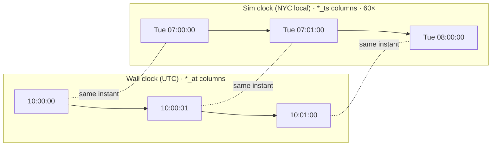

# Spec 01: Data preparation & replayer

## Purpose
Turn one month of historical NYC TLC yellow-taxi trips into a realistic, deterministic live stream on `trips.raw`, and be the single source of truth for simulated time (`sim.clock`).

## Responsibilities
- **Data prep** (`scripts/prepare_data.py`, `make data`), which runs once and offline afterwards:
  - Download the raw files.
  - Clean the time range, sort, and index.
  - Build `zones.csv` with centroids.
  - Print a data-quality preview.
- **Replayer** (`services/replayer`), a long-running service:
  - Publish rows in pickup order, paced by the sim clock.
  - Publish `sim.clock` heartbeats.
  - Persist its position.
  - Support pause/resume/speed, backfill mode, and looping.
  - Sample a fraction of trips for tracing.

<!-- diagrams:begin -->
## Diagrams
*Copied from [DIAGRAMS.md](../DIAGRAMS.md). Edit there, then run `make diagrams-sync`.*

**§11 Sim time vs wall time**



<!-- diagrams:end -->

## Interfaces
| Direction | What | Contract |
|---|---|---|
| in | `https://d37ci6vzurychx.cloudfront.net/trip-data/yellow_tripdata_${TLC_MONTH}.parquet` | TLC yellow schema |
| in | `https://d37ci6vzurychx.cloudfront.net/misc/taxi_zone_lookup.csv` | `LocationID,Borough,Zone,service_zone` |
| in | `https://d37ci6vzurychx.cloudfront.net/misc/taxi_zones.zip` | shapefile, EPSG:2263 |
| out (file) | `data/replay/trips_${TLC_MONTH}.parquet` | columns below, sorted by `pickup_ts` |
| out (file) | `data/zones.csv` | `location_id,borough,zone,service_zone,lat,lon` |
| out (file) | `data/taxi_zones.geojson` | zone polygons, EPSG:4326, simplified. Offline base layer for the Grafana geomap (spec 05) |
| out (topic) | `trips.raw` | [trip.schema.json](../../contracts/events/trip.schema.json) |
| out (topic) | `sim.clock` | [sim_clock.schema.json](../../contracts/events/sim_clock.schema.json) |
| out (topic) | `trace.checkpoints` (sampled trips only, stage `ingested`) | [trace_checkpoint.schema.json](../../contracts/events/trace_checkpoint.schema.json) |
| control (HTTP) | `127.0.0.1:8001` `GET /status`, `POST /pause`, `POST /resume`, `POST /speed {"speed": 120}` | header `X-Admin-Token: $ADMIN_TOKEN` |

## Config
`TLC_MONTH`, `DATA_DIR`, `KAFKA_BROKERS`, `REPLAY_SPEED` (number or `max`), `REPLAY_START_TS`, `REPLAY_UNTIL_TS`, `REPLAY_LOOP_OFFSET_DAYS`, `REPLAY_TRACE_SAMPLE_RATE`, `REPLAY_CLOCK_INTERVAL_S`, `REPLAY_STATE_PATH`, `REPLAY_CONTROL_PORT`, `ADMIN_TOKEN`. Defaults are in [.env.example](../../.env.example).

## Behaviour

### Data prep
1. Download the three files into `data/raw/` (skip them if already present and the size matches). Unzip the shapefile.
2. **Prepared replay file.** DuckDB does the renaming, filtering, and sorting:
   ```sql
   COPY (
     SELECT
       row_number() OVER (ORDER BY tpep_pickup_datetime, tpep_dropoff_datetime, PULocationID) - 1 AS row_idx,
       VendorID              AS vendor_id,
       tpep_pickup_datetime  AS pickup_ts,
       tpep_dropoff_datetime AS dropoff_ts,
       CAST(passenger_count AS INTEGER) AS passenger_count,
       trip_distance,
       CAST(RatecodeID AS INTEGER)      AS ratecode_id,
       store_and_fwd_flag,
       PULocationID AS pu_location_id,
       DOLocationID AS do_location_id,
       payment_type,
       fare_amount, extra, mta_tax, tip_amount, tolls_amount,
       improvement_surcharge, congestion_surcharge,
       COALESCE(Airport_fee, airport_fee)      AS airport_fee,        -- casing differs between years
       TRY_CAST(cbd_congestion_fee AS DOUBLE)  AS cbd_congestion_fee, -- present since 2025
       total_amount
     FROM read_parquet('data/raw/yellow_tripdata_${TLC_MONTH}.parquet', union_by_name = true)
     WHERE tpep_pickup_datetime >= TIMESTAMP '${MONTH_START}'
       AND tpep_pickup_datetime <  TIMESTAMP '${NEXT_MONTH_START}'
     ORDER BY row_idx
   ) TO 'data/replay/trips_${TLC_MONTH}.parquet' (FORMAT parquet, ROW_GROUP_SIZE 100000);
   ```
   Implement the column mapping tolerantly. Inspect `DESCRIBE` first and fill any missing optional column with `NULL`. Only the time filter is applied here. **Do not clean anything else.** Dirty rows (negative fares, zero distance, and so on) are kept deliberately, so the processor has something to reject on stage.
3. **Zones** (geopandas, run via `uv run --with geopandas`):
   - Read the shapefile and **dissolve by `LocationID`**, because some zones are multipart and duplicated.
   - Compute the centroid in EPSG:2263 (a projected CRS), then reproject it to EPSG:4326.
   - Left-join the lookup CSV. Ids 264 and 265 get `lat/lon = NULL`.
   - Write `data/zones.csv`.
   - Also write `data/taxi_zones.geojson`: the dissolved polygons in EPSG:4326, simplified (`simplify(20)` in EPSG:2263 feet before reprojecting), with properties `location_id, zone, borough`. Target size < 2 MB.
4. **Data-quality preview** (stdout and `data/replay/prep_report.json`):
   - Total rows, and rows dropped as out-of-month (with the min and max of the dropped timestamps).
   - A count per future validation reason code (same rules as spec 03), per day, and in total.
   - The busiest weekday, which is used to choose `REPLAY_START_TS`.

### Replayer pacing
- **State** is `{loop, row_idx, sim_ts}`.
  - On start, load `REPLAY_STATE_PATH` if it exists. Otherwise use `loop=0` and set `row_idx` to the first row with `pickup_ts ≥ REPLAY_START_TS`.
  - Save the state every 5 s and on SIGTERM. Write it atomically (write to a temp file, then rename).
- **Sim clock in live mode.** `sim_now = sim_anchor + (monotonic() − wall_anchor) × speed`.
  - Re-anchor (`sim_anchor = sim_now`, `wall_anchor = monotonic()`) on every resume and every speed change, so speed changes never jump.
  - While paused, `sim_now` is frozen.
- **Emit loop in live mode.** Read the parquet with pyarrow in row-group batches:
  ```
  offset = loop × REPLAY_LOOP_OFFSET_DAYS days
  while True:
      now = sim_now()
      while next_row.pickup_ts + offset ≤ now: produce(next_row, offset); advance()
      if end_of_file: loop += 1; row_idx = 0; offset = …
                      clock.jump_to(row0.pickup_ts + offset)   # skip the empty days (see below)
      sleep(min(0.02, time until next_row is due))
  ```
- **Loop wrap (live).** The next loop's first trip is 35 days after the month's first trip, so the month's last trip is followed by about 4 empty sim days (about 96 wall-minutes at 60×). At the wrap the clock **jumps forward** to that trip. Weekdays still line up (35 = 5 × 7), and sim time never moves backwards.
- **Backfill mode** (`REPLAY_SPEED=max`) produces as fast as the producer allows (use `produce()` and `poll(0)`, with `flush` every 10 k rows). `sim_now` is set to the `pickup_ts` of the last row produced. It stops, flushes, saves state, and exits 0 when `sim_now ≥ REPLAY_UNTIL_TS`. `sim.clock` is still emitted, with `mode="backfill"` and `speed="max"`.
- **Heartbeat.** Every `REPLAY_CLOCK_INTERVAL_S` of wall time, produce to `sim.clock`, key `clock`: `{sim_ts, at, speed, loop, row_idx, paused, mode}`.

### Message construction
- `trip_id = f"r{loop}-{row_idx:09d}"`. It's deterministic, so a replayer restart re-sending a row produces the same id, and ClickHouse dedups it.
- `pickup_ts` and `dropoff_ts` are shifted by the loop offset and formatted as naive ISO (`YYYY-MM-DDTHH:MM:SS`, no zone).
- NaN becomes `null`. Amounts are rounded to 2 decimals.
- `source="replay"`. `produced_at` = UTC now, in ms with a `Z`.
- **Trace sampling** is deterministic: set `trace_id = uuid5(NAMESPACE, trip_id)` if `hash(trip_id) mod 10_000 < REPLAY_TRACE_SAMPLE_RATE × 10_000`, otherwise `null`. For sampled trips, after the delivery callback confirms, produce the `ingested` checkpoint with `service="replayer"` and `detail={topic, partition, offset}`.
- **Producer settings** (confluent-kafka): `acks=all`, `enable.idempotence=true`, `linger.ms=20`, `compression.type=lz4`. Key = `trip_id`.

## Failure modes
| Failure | Behaviour |
|---|---|
| Broker unavailable | The producer buffers (up to 100 k messages), then the replayer pauses itself. It logs `broker_unavailable` and resumes when delivery works again. The sim clock is frozen while self-paused. |
| Crash or restart | Resume from the state file. At most 5 s of rows are re-sent (deduped downstream). |
| Parquet missing | Exit non-zero with a clear message: "run make data". |
| Clock drift (the laptop sleeps) | Re-anchoring on resume means no burst of millions of "late" rows. After a wall-clock gap > 10 s, auto-re-anchor. |

## Observability
- Log a JSON line every 10 s: `{event:"progress", sim_ts, loop, row_idx, rows_sent_10s, rate_per_s, producer_queue}`.
- `GET /status` returns the same data plus `paused` and `speed`.

## Acceptance criteria
1. `make data` on a clean machine produces the replay parquet (sorted, `row_idx` contiguous from 0), `zones.csv` (all 265 ids, and ≥ 258 of them with lat/lon), `taxi_zones.geojson` (< 2 MB, one feature per distinct shapefile `LocationID`), and `prep_report.json`, which lists every id without a geometry. The TLC shapefile has known duplicate ids (56 and 103 appear more than once, so ids 57, 104 and 105 have no geometry of their own). This is expected. Record it as a data-quality talking point.
2. A unit test with a fake clock at speed 60 produces exactly the rows with `pickup_ts ≤ start + 60 s × elapsed`, in order.
3. A unit test for speed change and pause/resume shows no sim-time jump (the new `sim_now` is within 1 sim second of the old one).
4. A unit test for looping shows row 0 of loop 1 has `pickup_ts = original + 35 days`, and `sim_ts` in the heartbeat is monotonic.
5. Integration: killing the replayer with SIGKILL and restarting it leads to duplicate `trip_id`s in `trips.raw` covering no more than 5 s of wall time. After `OPTIMIZE … FINAL`, `taxi.trips` has no duplicates.
6. Backfill `--until` stops within one row of the target and exits 0. A following live start continues from exactly that position.
7. Every produced message validates against `trip.schema.json` (contract test on 10 k sampled rows).
8. `sim.clock` receives ≥ 55 heartbeats per wall minute.

## Out of scope
Green taxis, FHV, and FHVHV (Uber/Lyft) data. Multiple months at once. Per-message schema-registry encoding.
