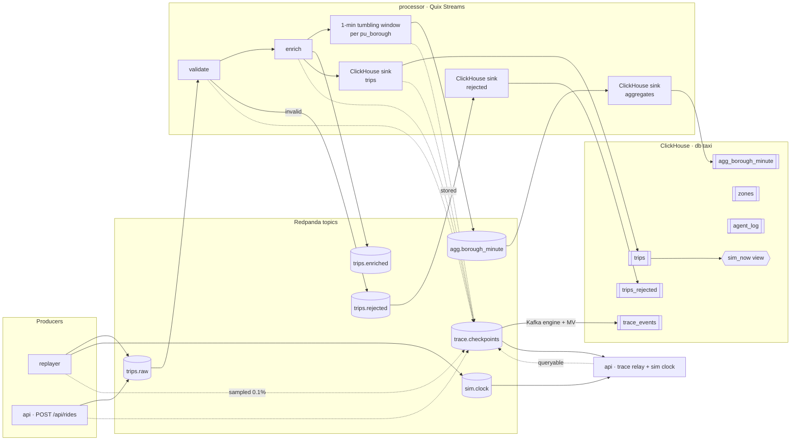

# Spec 02: Redpanda topics & event contracts

## Purpose
Define every topic and message so producers and consumers can be built and tested independently. `contracts/events/*.schema.json` is authoritative. This spec explains it.

## Responsibilities
- Topic bootstrap (`infra/redpanda/create-topics.sh`, run by a one-shot `redpanda-init` Compose service).
- Encoding and keying conventions.
- Contract tests shared by all services.

<!-- diagrams:begin -->
## Diagrams
*Copied from [DIAGRAMS.md](../DIAGRAMS.md). Edit there, then run `make diagrams-sync`.*

**§2 Topic & data-flow topology**



<!-- diagrams:end -->

## Config
`KAFKA_BROKERS` (all clients), `TOPIC_RETENTION_MS` (default 21 600 000 = 6 h, used by `create-topics.sh`).

## Topics
| Topic | Partitions | Key | Retention / cleanup | Producers | Consumers | Schema |
|---|---|---|---|---|---|---|
| `trips.raw` | 3 | `trip_id` | delete, 6 h | replayer, api (rides) | processor | [trip](../../contracts/events/trip.schema.json) |
| `trips.enriched` | 3 | `trip_id` | delete, 6 h | processor | (Console / future use) | [enriched_trip](../../contracts/events/enriched_trip.schema.json) |
| `trips.rejected` | 3 | `trip_id` | delete, 6 h | processor | processor (rejects sink) | [rejected_trip](../../contracts/events/rejected_trip.schema.json) |
| `agg.borough_minute` | 3 | `borough` | delete, 6 h | processor | processor (agg sink) | [borough_minute_agg](../../contracts/events/borough_minute_agg.schema.json) |
| `trace.checkpoints` | 3 | `trace_id` | delete, 6 h | api, replayer, processor | api (relay), ClickHouse Kafka engine | [trace_checkpoint](../../contracts/events/trace_checkpoint.schema.json) |
| `sim.clock` | 1 | `"clock"` | **compact** | replayer | api | [sim_clock](../../contracts/events/sim_clock.schema.json) |

Quix Streams also creates internal topics (`repartition__…` and `changelog__…`) for `group_by` and window state. Allow auto-creation for the processor's consumer group only, or pre-create them. **Don't delete these topics while the processor has state.**

Bootstrap:
```bash
rpk topic create trips.raw trips.enriched trips.rejected agg.borough_minute trace.checkpoints \
  -p 3 -r 1 -c retention.ms=${TOPIC_RETENTION_MS} -c cleanup.policy=delete
rpk topic create sim.clock -p 1 -r 1 -c cleanup.policy=compact
```
The script is idempotent: it ignores `TOPIC_ALREADY_EXISTS`.

## Behaviour

### Conventions
- **Encoding:** UTF-8 JSON, one object per message. No envelope. Headers are optional and informational only (`source`, `schema`=schema file name).
- **Naming:** `snake_case` fields. `*_ts` is sim time (naive ISO-8601), `*_at` is wall time (UTC ISO-8601 with ms and `Z`). See ARCHITECTURE §4.
- **Nulls:** optional values are explicit `null`, never omitted (keeps ClickHouse inserts uniform).
- **Evolution:** add optional fields only. Renaming or removing a field means a new topic version (`trips.raw.v2`) and an ADR.
- **Kafka timestamp:** producers leave it as the default (wall time). The processor uses `pickup_ts` as event time through its timestamp extractor (spec 03).

### Message catalogue (summary)
- **trip:** the raw TLC fields plus `trip_id`, `source`, `trace_id`, `loop`, `produced_at`.
- **enriched_trip:** trip, plus zone names, `payment_type_name`, `is_card`, `is_airport`, `duration_min`, `avg_speed_mph`, `tip_pct`, `pickup_hour`, `pickup_dow`, `processed_at`.
- **rejected_trip:** `trip_id`, `source`, `trace_id`, `pickup_ts`, `reasons[]` (reason codes), the original `payload` as a string, and `rejected_at`.
- **borough_minute_agg:** window bounds, borough, counts, revenue, averages, `student_trips`, `emitted_at`.
- **trace_checkpoint:** `trace_id`, `trip_id`, `source`, `stage`, `seq`, `service`, `at`, `detail{}`.
- **sim_clock:** `sim_ts`, `at`, `speed`, `loop`, `row_idx`, `paused`, `mode`.

Each schema file carries full field docs and at least one valid example.

### Contract tests
- `contracts/tests/test_examples.py` validates every schema against the 2020-12 metaschema and every `examples[]` entry against its schema. It uses a `referencing.Registry`, because `enriched_trip` references `trip`.
- Each producer has a test that builds messages with its real serializer and validates them against the schema.
- Each consumer has a test that its deserializer accepts every schema example.

## Failure modes
| Failure | Behaviour |
|---|---|
| Message fails JSON parsing in the processor | → `trips.rejected` with reason `SCHEMA_INVALID`, the raw bytes kept (decoded with `errors="replace"`) |
| Unknown extra field | Rejected by the contract test in CI. At runtime the processor ignores it (lenient reader) |
| Topic missing at startup | Services wait up to 60 s (`redpanda-init` is `service_completed_successfully` in Compose), then fail |

## Observability
Redpanda Console on the laptop screen shows the topics live. This is part of the demo ("look, here's the raw message"). Keep message payloads readable.

## Acceptance criteria
1. `create-topics.sh` run twice exits 0 both times. `rpk topic describe` matches the table above.
2. `make test` includes the contract tests, and they pass.
3. Consuming 1 minute of each topic and validating every message gives 0 schema violations.

## Out of scope
Schema registry, Avro/Protobuf, ACLs/SASL (single-host, localhost-bound broker).
