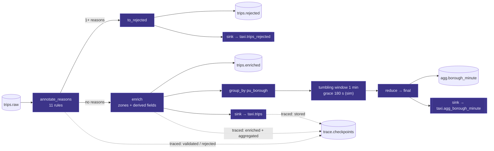

# Spec 03: Stream processor (Quix Streams)

## Purpose
Consume `trips.raw` and, in real time:
1. **clean** it: reject invalid records with explicit reasons,
2. **enrich** it: add zone and borough names and derived fields,
3. **aggregate** it: 1-minute tumbling windows per pickup borough,

then store everything in ClickHouse and emit trace checkpoints for traced records. This is the stage students should understand best, so keep the code short and readable.

## Responsibilities
- Validation (pure function, TDD).
- Enrichment (pure function, TDD) using the zones table loaded at startup.
- Branching into valid, rejected, and traced streams.
- Windowed aggregation in sim time.
- Sinks: `taxi.trips`, `taxi.trips_rejected`, `taxi.agg_borough_minute`.
- Trace checkpoints: `validated` | `rejected`, `enriched`, `aggregated`, `stored`.

<!-- diagrams:begin -->
## Diagrams
*Copied from [DIAGRAMS.md](../DIAGRAMS.md). Edit there, then run `make diagrams-sync`.*

**§12 Stream processor dataflow**



<!-- diagrams:end -->

## Interfaces
| Direction | What | Contract |
|---|---|---|
| in | `trips.raw` | [trip.schema.json](../../contracts/events/trip.schema.json) |
| in (file) | `PROCESSOR_ZONES_PATH` (`/data/zones.csv`, mounted read-only) | spec 01 |
| out | `trips.enriched` + sink `taxi.trips` | [enriched_trip.schema.json](../../contracts/events/enriched_trip.schema.json) |
| out | `trips.rejected` + sink `taxi.trips_rejected` | [rejected_trip.schema.json](../../contracts/events/rejected_trip.schema.json) |
| out | `agg.borough_minute` + sink `taxi.agg_borough_minute` | [borough_minute_agg.schema.json](../../contracts/events/borough_minute_agg.schema.json) |
| out | `trace.checkpoints` | [trace_checkpoint.schema.json](../../contracts/events/trace_checkpoint.schema.json) |

## Config
`KAFKA_BROKERS`, `PROCESSOR_CONSUMER_GROUP` (default `processor-v1`), `PROCESSOR_COMMIT_INTERVAL_S` (1), `PROCESSOR_WINDOW_GRACE_S` (180 sim seconds), `PROCESSOR_TIP_MAX_ABS` (100), `PROCESSOR_ZONES_PATH`, `CLICKHOUSE_HOST`, `CLICKHOUSE_HTTP_PORT`, `CLICKHOUSE_DB`, `CLICKHOUSE_INGEST_USER`, `CLICKHOUSE_INGEST_PASSWORD`. Quix state dir: `/state` (a Docker volume).

## Behaviour

### Application setup
```python
app = Application(
    broker_address=KAFKA_BROKERS,
    consumer_group=PROCESSOR_CONSUMER_GROUP,
    auto_offset_reset="earliest",
    commit_interval=PROCESSOR_COMMIT_INTERVAL_S,
    processing_guarantee="at-least-once",
    state_dir="/state",
)
raw = app.topic("trips.raw", value_deserializer="json", timestamp_extractor=pickup_ts_ms)
```
- `pickup_ts_ms` parses the naive `pickup_ts` **as if it were UTC** and returns epoch ms. This makes Quix windows run on **sim time**.
- If `pickup_ts` can't be parsed, the extractor returns the Kafka timestamp, and validation rejects the record anyway.
- Deserialization errors are routed to the rejected branch with `SCHEMA_INVALID`. Use an `on_processing_error` / `on_consumer_error` callback that produces to `trips.rejected` and returns `True` (skip). Never crash the app on bad input.

### Pipeline (StreamingDataFrame)
```python
sdf = app.dataframe(raw)
sdf = sdf.apply(annotate_reasons)                 # adds "_reasons": list[str]

traced = sdf[sdf.apply(lambda v: v["trace_id"] is not None)]
traced.apply(checkpoint_validated_or_rejected).to_topic(trace_topic, key=lambda v: v["trace_id"])

rejected = sdf[sdf.apply(lambda v: len(v["_reasons"]) > 0)].apply(to_rejected)
rejected.to_topic(rejected_topic)
rejected.sink(rejects_sink)

valid = sdf[sdf.apply(lambda v: len(v["_reasons"]) == 0)].apply(enrich)   # drops "_reasons"
valid.to_topic(enriched_topic)
valid.sink(trips_sink)                         # emits "stored" checkpoints after insert
valid[valid.apply(lambda v: v["trace_id"] is not None)] \
    .apply(checkpoints_enriched_and_aggregated, expand=True) \
    .to_topic(trace_topic, key=lambda v: v["trace_id"])

agg = (valid.group_by("pu_borough")
            .tumbling_window(timedelta(minutes=1), grace_ms=timedelta(seconds=PROCESSOR_WINDOW_GRACE_S))
            .reduce(reducer=add_trip, initializer=init_bucket)
            .final()
            .apply(to_agg_record))                 # {start,end,value} → contract fields
agg.to_topic(agg_topic)
agg.sink(agg_sink)
```
This is a sketch: adapt it to the pinned Quix version's branching API. The rules are **one pure function per concern**, and `app.py` should stay under about 120 lines.

### Validation rules (`annotate_reasons`)
Evaluate **all** rules and collect every failing code, so the dashboard can show the full picture.

| Code | Rule (record is invalid if…) | Why it exists in real data |
|---|---|---|
| `SCHEMA_INVALID` | not JSON, or a required field is missing or has the wrong type | defensive |
| `FARE_NON_POSITIVE` | `fare_amount ≤ 0` | refunds and disputes are recorded as negative |
| `TOTAL_NEGATIVE` | `total_amount < 0` | same |
| `DISTANCE_NON_POSITIVE` | `trip_distance ≤ 0` | meter not engaged, cancelled trips |
| `DISTANCE_TOO_LONG` | `trip_distance > 200` | meter glitches (values of 100 000+ exist) |
| `DROPOFF_NOT_AFTER_PICKUP` | `dropoff_ts ≤ pickup_ts` | clock errors |
| `DURATION_TOO_LONG` | `dropoff_ts − pickup_ts > 6 h` | meter left running |
| `LOCATION_INVALID` | `pu_location_id` or `do_location_id` ∉ [1, 265] | defensive (264/265 are *valid* "Unknown" zones) |
| `PASSENGER_COUNT_INVALID` | `passenger_count` not null and ∉ [0, 9] | data entry |
| `TIP_NEGATIVE` | `tip_amount < 0` | refunds |
| `TIP_UNREALISTIC` | `tip_amount > max(PROCESSOR_TIP_MAX_ABS, 3 × fare_amount)` | lets students trigger a rejection with an absurd tip |

The data-prep report (spec 01) uses the **same function**. Import it from a shared `rules.py`. Expect roughly 2–5% of real trips to be rejected, which is a good talking point.

### Enrichment (`enrich`)
| Field | Formula |
|---|---|
| `pu_zone`, `pu_borough`, `pu_service_zone` (and the `do_` equivalents) | lookup in `zones.csv` by id. For ids 264/265 or a missing id: zone and borough are `"Unknown"`, service_zone is `"Unknown"` |
| `payment_type_name` | map 0 Flex Fare, 1 Credit card, 2 Cash, 3 No charge, 4 Dispute, 5 Unknown, 6 Voided trip. Anything else → Unknown |
| `is_card` | `payment_type == 1` |
| `is_airport` | pickup or dropoff ∈ {1, 132, 138} |
| `duration_min` | `(dropoff_ts − pickup_ts)` in minutes, 2 decimals |
| `avg_speed_mph` | `trip_distance / (duration_min / 60)` if `duration_min ≥ 1`, else `null`. 2 decimals, computed from the unrounded duration |
| `tip_pct` | `100 × tip_amount / fare_amount` if `is_card` and `fare_amount > 0`, else `null`. 2 decimals |
| `pickup_hour` | hour of `pickup_ts` (0–23) |
| `pickup_dow` | ISO weekday of `pickup_ts` (1 = Mon) |
| `processed_at` | UTC now, ms |

### Aggregation (`init_bucket` / `add_trip` / `to_agg_record`)
- The bucket state is `{trips, revenue, fare_sum, distance_sum, card_trips, card_tip_pct_sum, card_tip_pct_n, student_trips}`.
- `to_agg_record` computes `avg_fare = fare_sum/trips`, `avg_distance`, and `avg_card_tip_pct = card_tip_pct_sum/card_tip_pct_n` (or `null`). It formats `window_start`/`window_end` from epoch ms back to naive ISO, and adds `borough` (the group key) and `emitted_at`.
- Windows close when the partition's observed event time passes `end + grace`.
  - At 60×, the 180 sim-second grace is about 3 wall seconds.
  - Records later than that are dropped by Quix. Log each as `late_record` with the trip_id; the expected count is 0.

### ClickHouse sinks
- Each sink is a `quixstreams.sinks.BatchingSink` subclass wrapping `clickhouse_connect.get_client(...)` with `ingest_writer`.
- `write(batch)` makes one `client.insert(table, rows, column_names=…)` per batch. The batch size is whatever accumulated in one commit interval (1 s), roughly 80–200 rows.
- On a connection or timeout error, raise `SinkBackpressureError(retry_after=5)`. Quix pauses the partition and retries, and Kafka buffers in the meantime. **Never drop a batch.**
- Column mapping: message fields map 1:1 to columns. Parse `*_ts` to `datetime` (naive) and `*_at` to aware UTC `datetime`. `stored_at` is left to the ClickHouse default.
- **`stored` checkpoints.** After a successful insert, for each row with a `trace_id`, produce a checkpoint `{stage:"stored", seq:6, service:"processor", detail:{table:"taxi.trips", batch_rows:N}}`. Use the app's producer (`app.get_producer()`) and flush once per batch. The rejects sink emits no checkpoint, because a rejected trace already ended at `rejected`.

### Trace checkpoints emitted here
| Stage | seq | Emitted when | `detail` |
|---|---|---|---|
| `validated` | 3 | all rules passed | `{rules_checked: 11}` |
| `rejected` | 3 | any rule failed | `{reasons: [...]}` |
| `enriched` | 4 | after `enrich` | `{pu_zone, pu_borough, do_zone, do_borough, tip_pct, duration_min}` |
| `aggregated` | 5 | the record entered its window (emitted with `enriched`) | `{window_start, borough}` |
| `stored` | 6 | the ClickHouse insert returned OK | `{table, batch_rows}` |

All checkpoints: `trace_id`, `trip_id`, `source`, `service:"processor"`, and `at` = UTC now.

## Failure modes
| Failure | Behaviour |
|---|---|
| ClickHouse down | Backpressure. Consumption pauses and lag grows. The processor resumes automatically, with no loss |
| Processor crash | Restart from the last committed offset, with up to ~1 s of reprocessing. Duplicates collapse in ReplacingMergeTree. Window state is restored from the changelog topic |
| Bad record | Rejected with a reason, never a crash |
| Zones file missing | Fail fast on startup with a clear error |
| Window logic changed | Bump `PROCESSOR_CONSUMER_GROUP` (for example `processor-v2`) and clear the `/state` volume. Document it in the RUNBOOK |

## Observability
- Log a JSON line every 10 s: `{event:"progress", in, valid, rejected, by_reason:{…}, windows_emitted, sink_rows, sink_ms_p95, late_records}`.
- Grafana "Stand Health" reads freshness from ClickHouse (spec 05).

## Acceptance criteria
1. Unit tests: one positive and one negative case per validation rule, a multi-reason case, and the exact enrichment values for the example in `enriched_trip.schema.json`.
2. Unit test: `tip_pct` is `null` for cash trips and for `fare_amount = 0`.
3. Unit test: the reducer and `to_agg_record` over 3 fixture trips produce exactly the expected averages, and `avg_card_tip_pct = null` when there are no card trips.
4. Integration (testcontainers Redpanda + ClickHouse), producing 1 000 fixture trips including 50 known-bad ones:
   - `taxi.trips` has 950 rows and `taxi.trips_rejected` has 50, with the expected reasons.
   - `taxi.agg_borough_minute` sums to 950 trips.
5. Integration: a traced trip produces exactly `validated, enriched, aggregated, stored`, in that order, each validating against the schema. A traced bad trip produces exactly `rejected`.
6. Integration: stopping ClickHouse for 30 s during a run means 0 lost rows once it's back.
7. Every message on `trips.enriched`, `trips.rejected`, and `agg.borough_minute` validates against its schema.
8. Steady state at 60×: the p95 of `stored_at − produced_at` in `taxi.trips` is < 2 s.

## Out of scope
Exactly-once into ClickHouse, multiple processor replicas, per-zone windows (the agent computes those in SQL), and joins against other datasets such as weather.
