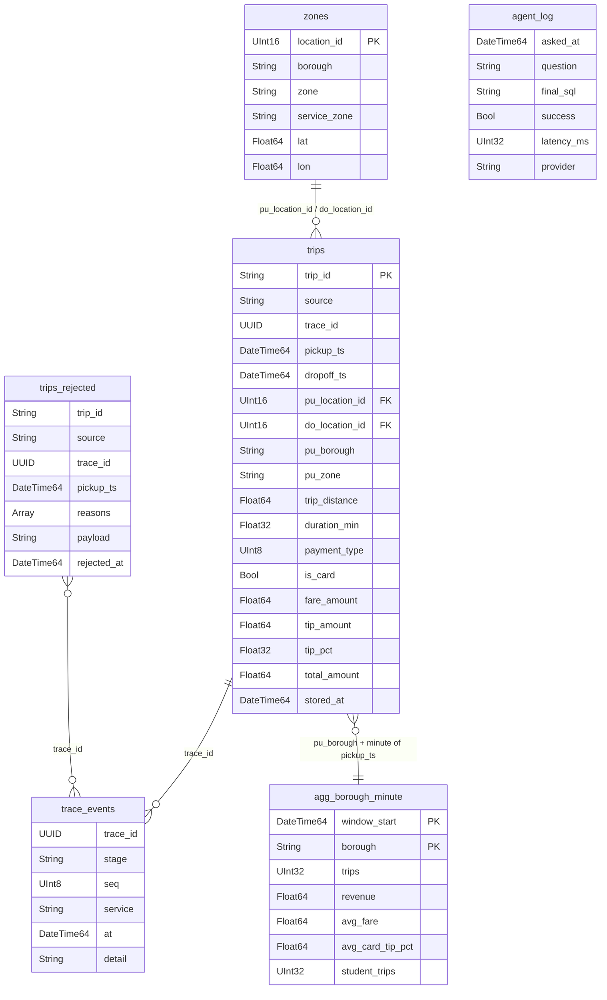

# Spec 04: ClickHouse schema, users & limits

## Purpose
The analytical store behind the dashboard, the AI agent, and the trace viewer.

**The schema *is* the agent's knowledge.** Every column in an agent-visible table has a `COMMENT` that `describe_table` returns (ADR-008). A better data model makes a better agent, and that's the lesson for students.

## Responsibilities
- DDL for database `taxi` (idempotent, `IF NOT EXISTS`) in `infra/clickhouse/init/NN_*.sql`.
- Users, profiles, quotas, and grants in `infra/clickhouse/users.d/*.xml`.
- The zones loader (`infra/clickhouse/init/90_load_zones.sh`).
- The server config: timezone UTC, memory cap, and logging (`infra/clickhouse/config.d/*.xml`).

<!-- diagrams:begin -->
## Diagrams
*Copied from [DIAGRAMS.md](../DIAGRAMS.md). Edit there, then run `make diagrams-sync`.*

**§6 ClickHouse schema: ER diagram**



<!-- diagrams:end -->

## Interfaces
| Consumer | User | Access |
|---|---|---|
| processor sinks, api (`agent_log` insert) | `ingest_writer` | INSERT on `taxi.trips`, `taxi.trips_rejected`, `taxi.agg_borough_minute`, `taxi.agent_log` |
| agent (`run_query`, `describe_table`), api (`queryable` poll, fare estimate) | `agent_ro` | SELECT on the agent whitelist (below), `readonly=1`, hard limits |
| Grafana | `grafana_ro` | SELECT on `taxi.*`, `system.parts`, `system.query_log`. `readonly=2` + constraints |
| operators (make, migrations) | `admin` (from `CLICKHOUSE_ADMIN_PASSWORD`) | all, localhost only |

**Agent whitelist:** `taxi.trips`, `taxi.trips_rejected`, `taxi.agg_borough_minute`, `taxi.zones`, `taxi.sim_now`, `taxi.trace_events`. `taxi.agent_log` is **not** on the list, because it holds other visitors' questions.

## Config
`CLICKHOUSE_DB`, `CLICKHOUSE_ADMIN_PASSWORD`, `CLICKHOUSE_INGEST_PASSWORD`, `CLICKHOUSE_AGENT_PASSWORD`, `CLICKHOUSE_GRAFANA_PASSWORD`. Passwords are injected into the users XML with `from_env`.

## Behaviour

### Server settings (`config.d/stand.xml`)
- `<timezone>UTC</timezone>`. **Required** by the sim-time model (ARCHITECTURE §4).
- `<max_server_memory_usage_to_ram_ratio>0.8</max_server_memory_usage_to_ram_ratio>`, with the container `mem_limit: 4g`.
- The `default` user may connect from localhost only. Log level is `warning`. Enable `query_log` (the soak test uses it).

### DDL

```sql
-- 00_database.sql
CREATE DATABASE IF NOT EXISTS taxi;

-- 10_zones.sql
CREATE TABLE IF NOT EXISTS taxi.zones
(
    location_id  UInt16                 COMMENT 'TLC taxi zone id, 1-265. Join target for trips.pu_location_id / do_location_id.',
    borough      LowCardinality(String) COMMENT 'Manhattan, Brooklyn, Queens, Bronx, Staten Island, EWR (Newark airport), Unknown, N/A.',
    zone         String                 COMMENT 'Zone name, e.g. ''JFK Airport'', ''Midtown Center'', ''Williamsburg (North Side)''.',
    service_zone LowCardinality(String) COMMENT 'Yellow Zone = Manhattan core; Boro Zone = outer boroughs; Airports; EWR.',
    lat          Nullable(Float64)      COMMENT 'Zone centroid latitude (WGS84). NULL for 264/265 and the few zones without their own shape.',
    lon          Nullable(Float64)      COMMENT 'Zone centroid longitude (WGS84). NULL for 264/265.'
)
ENGINE = MergeTree ORDER BY location_id
COMMENT 'The 265 NYC TLC taxi zones with borough and centroid coordinates.';

-- 20_trips.sql
CREATE TABLE IF NOT EXISTS taxi.trips
(
    trip_id               String                 COMMENT 'Unique trip id. r{loop}-{row} = real replayed trip; s-{uuid} = ride created by a visitor at the stand.',
    source                LowCardinality(String) COMMENT '''replay'' = real NYC yellow-taxi trip; ''student'' = ride created by a visitor at our stand today.',
    trace_id              Nullable(UUID)         COMMENT 'Set for traced trips: every student ride and ~0.1% of replayed trips. Use it to find a visitor''s own ride.',
    loop                  UInt16                 COMMENT 'Internal replay loop counter. Ignore for analysis.',
    vendor_id             Nullable(UInt8)        COMMENT 'Taximeter technology vendor id. Rarely useful.',
    pickup_ts             DateTime64(3)          COMMENT 'Pickup time in NYC local time on the SIMULATED clock. For "now", "today", "last hour" use taxi.sim_now, never now().',
    dropoff_ts            DateTime64(3)          COMMENT 'Dropoff time, NYC local, simulated clock.',
    pickup_hour           UInt8                  COMMENT 'Hour of pickup 0-23 (NYC local). Morning rush ≈ 7-9, evening rush ≈ 16-19.',
    pickup_dow            UInt8                  COMMENT 'ISO day of week of pickup: 1 = Monday … 7 = Sunday.',
    passenger_count       Nullable(UInt8)        COMMENT 'Driver-entered passenger count. 0 and NULL are common, so treat it as unreliable.',
    trip_distance         Float64                COMMENT 'Distance in miles, from the taximeter.',
    duration_min          Float32                COMMENT 'Trip duration in minutes.',
    avg_speed_mph         Nullable(Float32)      COMMENT 'Average speed in miles per hour. NULL for trips shorter than 1 minute.',
    ratecode_id           Nullable(UInt8)        COMMENT '1 Standard, 2 JFK flat fare, 3 Newark, 4 Nassau/Westchester, 5 Negotiated, 6 Group ride, 99 Unknown.',
    store_and_fwd_flag    LowCardinality(Nullable(String)) COMMENT 'Internal meter flag. Ignore.',
    pu_location_id        UInt16                 COMMENT 'Pickup zone id. Join taxi.zones ON location_id for coordinates.',
    pu_zone               LowCardinality(String) COMMENT 'Pickup zone name.',
    pu_borough            LowCardinality(String) COMMENT 'Pickup borough. Exclude ''Unknown'' and ''N/A'' when comparing boroughs. EWR (Newark airport) has very few pickups, so exclude it or require a minimum trip count when ranking.',
    pu_service_zone       LowCardinality(String) COMMENT 'Pickup service zone: Yellow Zone, Boro Zone, Airports, EWR.',
    do_location_id        UInt16                 COMMENT 'Dropoff zone id.',
    do_zone               LowCardinality(String) COMMENT 'Dropoff zone name.',
    do_borough            LowCardinality(String) COMMENT 'Dropoff borough.',
    do_service_zone       LowCardinality(String) COMMENT 'Dropoff service zone.',
    payment_type          UInt8                  COMMENT '0 Flex Fare, 1 Credit card, 2 Cash, 3 No charge, 4 Dispute, 5 Unknown, 6 Voided trip.',
    payment_type_name     LowCardinality(String) COMMENT 'Readable payment type.',
    is_card               Bool                   COMMENT 'TRUE when paid by credit card. IMPORTANT: tips are ONLY recorded for card payments, so always filter is_card for tip questions.',
    is_airport            Bool                   COMMENT 'TRUE when pickup or dropoff is JFK, LaGuardia or Newark.',
    fare_amount           Float64                COMMENT 'Metered time-and-distance fare in USD, excluding tip, taxes, tolls and surcharges.',
    extra                 Float64                COMMENT 'Misc extras and surcharges in USD (rush hour, overnight).',
    mta_tax               Float64                COMMENT 'MTA tax in USD.',
    tip_amount            Float64                COMMENT 'Tip in USD. ONLY recorded for card payments. Cash tips are missing, so cash trips show 0.',
    tip_pct               Nullable(Float32)      COMMENT 'Tip as a percentage of fare_amount. Only set for card trips with fare > 0, NULL otherwise. Best column for "who tips best" questions.',
    tolls_amount          Float64                COMMENT 'Bridge and tunnel tolls in USD.',
    improvement_surcharge Float64                COMMENT 'Improvement surcharge in USD.',
    congestion_surcharge  Float64                COMMENT 'NY State congestion surcharge in USD (trips in Manhattan south of 96th St).',
    airport_fee           Float64                COMMENT 'Airport pickup fee in USD (JFK and LaGuardia).',
    cbd_congestion_fee    Float64                COMMENT 'MTA congestion-pricing fee in USD for trips entering Manhattan below 60th St (since 2025-01-05).',
    total_amount          Float64                COMMENT 'Total charged in USD, including the recorded tip, taxes, tolls and surcharges.',
    produced_at           DateTime64(3, 'UTC')   COMMENT 'Pipeline internal: wall-clock UTC time the trip entered Redpanda.',
    processed_at          DateTime64(3, 'UTC')   COMMENT 'Pipeline internal: wall-clock UTC time the stream processor enriched it.',
    stored_at             DateTime64(3, 'UTC') DEFAULT now64(3) COMMENT 'Pipeline internal: wall-clock UTC time it was written to ClickHouse.',
    INDEX idx_trace_id trace_id TYPE bloom_filter GRANULARITY 4
)
ENGINE = ReplacingMergeTree(stored_at)
PARTITION BY toYYYYMM(pickup_ts)
ORDER BY (pickup_ts, trip_id)
COMMENT 'One row per valid, enriched NYC yellow-taxi trip (plus rides created by stand visitors). The main table for analysis.';

-- 21_sim_now.sql
CREATE VIEW IF NOT EXISTS taxi.sim_now
AS SELECT
    max(pickup_ts)                 AS now_ts,
    toDate(max(pickup_ts))         AS today,
    toStartOfHour(max(pickup_ts))  AS this_hour
FROM taxi.trips
WHERE source = 'replay'
COMMENT 'The current SIMULATED time. Use it for "now", "today", "last hour", e.g. WHERE pickup_ts >= (SELECT now_ts FROM taxi.sim_now) - INTERVAL 1 HOUR';

-- 30_trips_rejected.sql
CREATE TABLE IF NOT EXISTS taxi.trips_rejected
(
    trip_id     String                        COMMENT 'Id of the rejected trip.',
    source      LowCardinality(String)        COMMENT '''replay'' or ''student''.',
    trace_id    Nullable(UUID)                COMMENT 'Set if the trip was traced.',
    pickup_ts   Nullable(DateTime64(3))       COMMENT 'Pickup time (NYC local, simulated), NULL if unparseable.',
    reasons     Array(LowCardinality(String)) COMMENT 'Every validation rule the trip failed, e.g. [''FARE_NON_POSITIVE'',''TOTAL_NEGATIVE'']. Use arrayJoin(reasons) to count by reason.',
    payload     String                        COMMENT 'The original raw message as JSON.' CODEC(ZSTD(3)),
    rejected_at DateTime64(3, 'UTC')          COMMENT 'Pipeline internal: wall-clock UTC time of rejection.'
)
ENGINE = ReplacingMergeTree(rejected_at)
PARTITION BY toYYYYMM(rejected_at)
ORDER BY trip_id
COMMENT 'Trips the stream processor rejected as invalid (data-quality dead-letter table). Reason codes: SCHEMA_INVALID, FARE_NON_POSITIVE, TOTAL_NEGATIVE, DISTANCE_NON_POSITIVE, DISTANCE_TOO_LONG, DROPOFF_NOT_AFTER_PICKUP, DURATION_TOO_LONG, LOCATION_INVALID, PASSENGER_COUNT_INVALID, TIP_NEGATIVE, TIP_UNREALISTIC.';

-- 40_agg_borough_minute.sql
CREATE TABLE IF NOT EXISTS taxi.agg_borough_minute
(
    window_start     DateTime64(3)          COMMENT 'Start of the 1-minute window (NYC local, simulated clock).',
    window_end       DateTime64(3)          COMMENT 'End of the window (exclusive).',
    borough          LowCardinality(String) COMMENT 'Pickup borough.',
    trips            UInt32                 COMMENT 'Valid trips picked up in this borough in this minute.',
    revenue          Float64                COMMENT 'Sum of total_amount in USD.',
    avg_fare         Float64                COMMENT 'Average fare_amount in USD.',
    avg_distance     Float64                COMMENT 'Average trip_distance in miles.',
    card_trips       UInt32                 COMMENT 'Trips paid by card.',
    avg_card_tip_pct Nullable(Float64)      COMMENT 'Average tip_pct over card trips. NULL if none.',
    student_trips    UInt32                 COMMENT 'How many of the trips were created by stand visitors.',
    emitted_at       DateTime64(3, 'UTC')   COMMENT 'Pipeline internal: when the processor closed the window.'
)
ENGINE = ReplacingMergeTree(emitted_at)
PARTITION BY toYYYYMM(window_start)
ORDER BY (window_start, borough)
COMMENT 'Pre-aggregated trips per pickup borough per minute, computed live by the stream processor. Fast for time series. Use taxi.trips for anything else.';

-- 50_trace_events.sql
CREATE TABLE IF NOT EXISTS taxi.trace_events
(
    trace_id UUID                   COMMENT 'Trace id of the trip.',
    trip_id  String                 COMMENT 'Trip id.',
    source   LowCardinality(String) COMMENT '''replay'' or ''student''.',
    stage    LowCardinality(String) COMMENT 'submitted, ingested, validated, rejected, enriched, aggregated, stored, queryable.',
    seq      UInt8                  COMMENT 'Stage order 1-7 (rejected = 3).',
    service  LowCardinality(String) COMMENT 'Service that emitted the checkpoint.',
    at       DateTime64(3, 'UTC')   COMMENT 'Wall-clock UTC time the stage completed. Latency between stages = difference of at.',
    detail   String                 COMMENT 'Stage details as JSON.'
)
ENGINE = MergeTree
ORDER BY (trace_id, seq, at)
TTL toDateTime(at) + INTERVAL 14 DAY
COMMENT 'One row per pipeline stage a traced trip passed through. Use it for pipeline latency questions.';

CREATE TABLE IF NOT EXISTS taxi.trace_events_queue
(
    trace_id UUID, trip_id String, source String, stage String,
    seq UInt8, service String, at String, detail String
)
ENGINE = Kafka
SETTINGS kafka_broker_list = 'redpanda:9092',
         kafka_topic_list = 'trace.checkpoints',
         kafka_group_name = 'clickhouse-trace-events',
         kafka_format = 'JSONEachRow',
         kafka_num_consumers = 1,
         kafka_skip_broken_messages = 100;
-- JSONEachRow reads the nested `detail` object into a String column
-- (input_format_json_read_objects_as_strings, on by default in recent versions; verify at M0).

CREATE MATERIALIZED VIEW IF NOT EXISTS taxi.trace_events_mv TO taxi.trace_events AS
SELECT trace_id, trip_id, source, stage, seq, service,
       parseDateTime64BestEffort(at, 3, 'UTC') AS at, detail
FROM taxi.trace_events_queue;

-- 60_agent_log.sql
CREATE TABLE IF NOT EXISTS taxi.agent_log
(
    asked_at       DateTime64(3, 'UTC'),
    request_id     UUID,
    origin         LowCardinality(String),   -- suggested | typed | ride
    suggestion_id  LowCardinality(String),   -- '' unless origin = suggested
    trace_id       Nullable(UUID),
    question       String,
    provider       LowCardinality(String),   -- local | internal | cache
    model          LowCardinality(String),
    mode           LowCardinality(String),   -- tools | oneshot | cached
    sql_attempts   Array(String),
    final_sql      String,
    success        Bool,
    refused        Bool,
    error          String,
    result_rows    UInt32,
    tool_calls     UInt8,
    latency_ms     UInt32,
    first_event_ms UInt32
)
ENGINE = MergeTree
PARTITION BY toYYYYMMDD(asked_at)
ORDER BY asked_at
COMMENT 'Operator-only log of agent questions. NOT visible to the agent.';
```

**Null handling for inserts.** The optional surcharge fields (`extra`, `mta_tax`, `tolls_amount`, `improvement_surcharge`, `congestion_surcharge`, `airport_fee`, `cbd_congestion_fee`) arrive as `null` in messages, and the sink coalesces them to `0.0`. `tip_pct`, `avg_speed_mph`, `passenger_count`, `ratecode_id`, `vendor_id`, and `trace_id` stay Nullable.

### Users, profiles, quotas (`users.d/stand.xml`, sketch)
```xml
<clickhouse>
  <profiles>
    <ingest>
      <max_memory_usage>1000000000</max_memory_usage>
    </ingest>
    <agent>
      <readonly>1</readonly>
      <max_execution_time>5</max_execution_time>
      <timeout_overflow_mode>throw</timeout_overflow_mode>
      <max_result_rows>5000</max_result_rows>
      <result_overflow_mode>throw</result_overflow_mode>
      <max_rows_to_read>100000000</max_rows_to_read>
      <max_memory_usage>1000000000</max_memory_usage>
      <max_threads>2</max_threads>
      <max_query_size>20000</max_query_size>
      <allow_introspection_functions>0</allow_introspection_functions>
    </agent>
    <grafana>
      <readonly>2</readonly>
      <max_execution_time>15</max_execution_time>
      <max_memory_usage>1000000000</max_memory_usage>
      <max_threads>2</max_threads>
      <constraints>
        <max_execution_time><max>30</max></max_execution_time>
        <max_memory_usage><max>1000000000</max></max_memory_usage>
        <max_threads><max>4</max></max_threads>
      </constraints>
    </grafana>
  </profiles>
  <quotas>
    <agent>
      <interval><duration>60</duration><queries>120</queries><errors>60</errors><execution_time>120</execution_time></interval>
    </agent>
  </quotas>
  <users>
    <ingest_writer>
      <password from_env="CLICKHOUSE_INGEST_PASSWORD"/>
      <profile>ingest</profile><quota>default</quota>
      <networks><ip>::/0</ip></networks>   <!-- the Compose network only; the port is not published to the LAN -->
      <grants>
        <query>GRANT INSERT ON taxi.trips</query>
        <query>GRANT INSERT ON taxi.trips_rejected</query>
        <query>GRANT INSERT ON taxi.agg_borough_minute</query>
        <query>GRANT INSERT ON taxi.agent_log</query>
      </grants>
    </ingest_writer>
    <agent_ro>
      <password from_env="CLICKHOUSE_AGENT_PASSWORD"/>
      <profile>agent</profile><quota>agent</quota>
      <networks><ip>::/0</ip></networks>
      <grants>
        <query>GRANT SELECT ON taxi.trips</query>
        <query>GRANT SELECT ON taxi.trips_rejected</query>
        <query>GRANT SELECT ON taxi.agg_borough_minute</query>
        <query>GRANT SELECT ON taxi.zones</query>
        <query>GRANT SELECT ON taxi.sim_now</query>
        <query>GRANT SELECT ON taxi.trace_events</query>
      </grants>
    </agent_ro>
    <grafana_ro>
      <password from_env="CLICKHOUSE_GRAFANA_PASSWORD"/>
      <profile>grafana</profile><quota>default</quota>
      <networks><ip>::/0</ip></networks>
      <grants>
        <query>GRANT SELECT ON taxi.*</query>
        <query>GRANT SELECT ON system.parts</query>       <!-- Stand Health dashboard -->
        <query>GRANT SELECT ON system.query_log</query>
      </grants>
    </grafana_ro>
  </users>
</clickhouse>
```
If the pinned `clickhouse-connect` version refuses to work with a `readonly=1` user (because it tries to send session settings), use `readonly=2` for `agent`. Add `<constraints>` with `<readonly/>` on **every** limit above so they can't be overridden, and record this as an ADR. Acceptance test 3 must pass either way.

### Zones loader
`90_load_zones.sh` runs `clickhouse-client --input_format_csv_empty_as_default=1 --query "INSERT INTO taxi.zones FORMAT CSVWithNames" < /data/zones.csv`, only if `SELECT count() FROM taxi.zones` = 0. Empty lat/lon values become `NULL`.

### Migrations
The init scripts only run on an empty data volume. `make migrate` re-applies all `init/*.sql` as admin (they're idempotent). Any destructive change needs a new numbered file and a note in the RUNBOOK.

### Timezones
- The server is UTC.
- `*_ts` columns (`DateTime64(3)`, no explicit timezone) store sim time as naive NYC local values. Never apply `toTimeZone` to them.
- `*_at` columns are `DateTime64(3,'UTC')`.
- Grafana dashboards use timezone `utc` (spec 05).

## Failure modes
| Failure | Behaviour |
|---|---|
| Too many parts | Prevented by 1 s batches. Monitored via `system.parts` in the soak test (alert if active parts per partition > 300) |
| Duplicates after a replay or processor restart | ReplacingMergeTree collapses them on merge. The error in `count()` is negligible. Use `FINAL` only in tests |
| Kafka engine consumer stuck | The `trace_events` table stops growing, but the live trace viewer is unaffected (the api relay reads the topic directly). Fix: `DETACH`/`ATTACH TABLE taxi.trace_events_queue` |
| Agent query too heavy | Killed at 5 s (`TIMEOUT_EXCEEDED`), and the agent gets the error and can repair the query |

## Observability
The Stand Health dashboard (spec 05) queries `system.parts`, `system.query_log` (the agent_ro error rate), and freshness.

## Acceptance criteria
1. Applying all init scripts twice on a fresh volume succeeds, and `SHOW TABLES FROM taxi` lists exactly: `agent_log, agg_borough_minute, sim_now, trace_events, trace_events_mv, trace_events_queue, trips, trips_rejected, zones`.
2. `taxi.zones` has 265 rows, and ≥ 258 of them have non-null lat/lon (see spec 01 on duplicate shapefile ids).
3. As `agent_ro`:
   - `INSERT`, `ALTER`, `DROP`, `CREATE`, `SET max_execution_time=100`, `SELECT … SETTINGS max_result_rows=10000`, `SELECT * FROM taxi.agent_log`, and `SELECT * FROM system.users` **all fail**.
   - `SELECT count() FROM taxi.trips a CROSS JOIN taxi.trips b` fails with a timeout or limit error within 6 s.
   - `SELECT number FROM numbers(10000)` fails with `TOO_MANY_ROWS_OR_BYTES`, and 500 rows still work.
   - The cap is `max_result_rows=5000` with `throw`: `break` only checks per block (it let 10 000 rows through), and clickhouse-connect reads about 1.5 k rows of `system.settings` when it connects. The agent's normal limit is the SQL guard's `LIMIT 200` (spec 06). This is only the hard wall.
4. Every column of every agent-whitelisted **table** has a non-empty comment. Check with `SELECT table, name FROM system.columns WHERE database='taxi' AND comment=''` (excluding `agent_log`, `trace_events_queue`, and the `sim_now` view, whose three columns are documented in its table `COMMENT`).
5. A checkpoint produced to `trace.checkpoints` shows up in `taxi.trace_events` within 10 s.
6. `SELECT * FROM taxi.sim_now` returns in < 50 ms with 4 M rows.

## Out of scope
Replication, backups (the data is reproducible from `make data` + backfill), a dictionary engine for zones (the processor denormalises instead), and projections (add only if a panel is slow).
