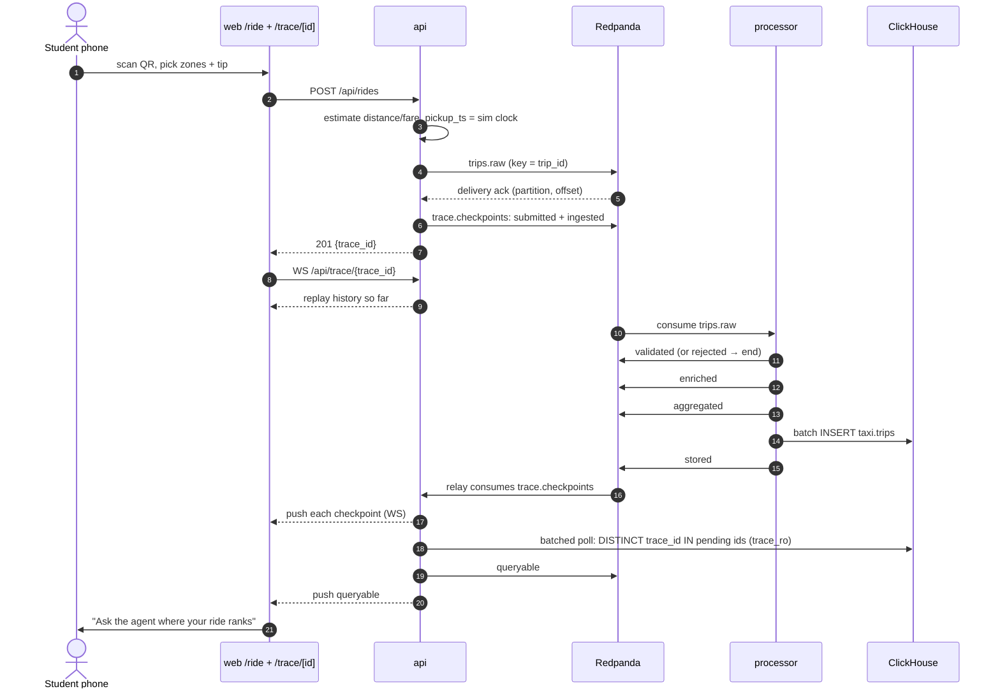
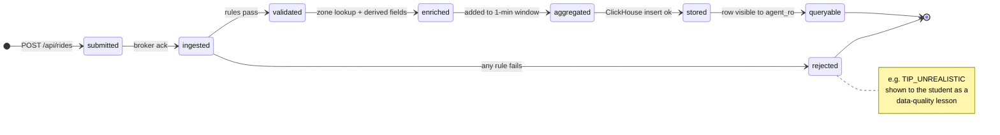

# Spec 07: Trace your ride

## Purpose
A student scans a QR code, books a fake taxi ride (pickup zone, dropoff zone, tip), and watches **their** ride move through every pipeline stage, with the latency of each hop. At the end they ask the agent "Where does my ride rank for tips today?"

It makes the abstract pipeline personal. It's optional: the core demo works without it (cut line 4).

## Responsibilities
- The rides API: validation, fare estimation, a sim-clock timestamp, producing to `trips.raw`, and the `submitted`/`ingested` checkpoints.
- The trace relay: consume `trace.checkpoints`, keep short-term history, and fan out over WebSocket.
- The `queryable` detector: confirm the row is visible to `agent_ro`.
- The stage copy (student-facing explanations) and the hand-off to the agent.
- The processor-side checkpoints are specified in [spec 03](03-stream-processor.md#trace-checkpoints-emitted-here). The UI is in [spec 08](08-web-frontend.md).

<!-- diagrams:begin -->
## Diagrams
*Copied from [DIAGRAMS.md](../DIAGRAMS.md). Edit there, then run `make diagrams-sync`.*

**§4 Trace your ride: sequence**



**§5 Trace checkpoint stages: state machine**



<!-- diagrams:end -->

## Interfaces
| Method & path | Purpose |
|---|---|
| `GET /api/zones` | `[{location_id, zone, borough}]` for 1–263, sorted by borough then zone (from `taxi.zones`, cached) |
| `GET /api/rides/estimate?pickup_location_id=&dropoff_location_id=` | `{trip_distance, duration_min, fare_amount, method}`, the same estimator as below. Used by the form before booking |
| `POST /api/rides` | Create a ride → `201` (see below) |
| `GET /api/trace/{trace_id}` | `{trace_id, checkpoints}` — the merged history (memory ∪ `taxi.trace_events`) as a one-shot fetch, for a page that doesn't need the live WS (or a reload before the WS reconnects). `404` if there's no such trace |
| `WS /api/trace/{trace_id}` | History + live checkpoints for one ride |
| `WS /api/trace/live` | All student checkpoints + sampled replay checkpoints + a 1 Hz sim clock (the big-screen wall) |
| `GET /api/sim/clock` | Latest `sim.clock` message |

### `POST /api/rides`
Request (all fields required):
```json
{ "pickup_location_id": 230, "dropoff_location_id": 132, "payment": "card", "tip_amount": 5.00, "passenger_count": 1 }
```
| Field | Validation (→ 422 if violated) |
|---|---|
| `pickup_location_id`, `dropoff_location_id` | integer 1–263 |
| `payment` | `"card"` or `"cash"` |
| `tip_amount` | number, 0–999, 2 decimals. **Absurd tips are allowed on purpose**, so the *processor* rejects them (a lesson) |
| `passenger_count` | integer 1–6 |

Response `201`:
```json
{
  "trace_id": "3f2c9a1e-8b7d-4c21-9e55-0a1b2c3d4e5f",
  "trip_id": "s-3f2c9a1e-8b7d-4c21-9e55-0a1b2c3d4e5f",
  "trace_url": "/trace/3f2c9a1e-8b7d-4c21-9e55-0a1b2c3d4e5f",
  "pickup_ts": "2025-10-09T17:42:00",
  "estimate": { "trip_distance": 3.1, "duration_min": 16.5, "fare_amount": 19.5, "total_amount": 29.25,
                "method": "median of 214 real trips between these zones" },
  "notes": []
}
```
`notes` contains "NYC taxi data doesn't record cash tips, so your tip will show as $0" when `payment = "cash"`.

Errors: `429` for the rate limit (`RIDES_RATE_LIMIT_PER_MIN` per IP, plus a global 30/min: "The dispatcher is busy, try again in a few seconds"). `503` if the broker doesn't acknowledge within 2 s, and `503` "The zone list is still loading, try again in a moment" if the zone list isn't cached yet and ClickHouse refuses the query.

**Public reads.** `GET /api/rides/estimate`, `GET /api/trace/{id}` and each `WS /api/trace/{id}` or `/api/trace/live` connect share one per-IP token bucket of `TRACE_READ_RATE_LIMIT_PER_MIN` (default 120), because they use the same `trace_ro` quota as the queryable poller. Over the limit, a GET gets `429` `{"detail": "Too many requests, try again in a few seconds", "retry_after_s": n}` with a `Retry-After` header, and a WebSocket is accepted and then closed with code `1013` (the web client reconnects with its back-off).

## Config
`RIDES_RATE_LIMIT_PER_MIN`, `RIDES_GLOBAL_PER_MIN`, `TRACE_READ_RATE_LIMIT_PER_MIN`, `TRACE_HISTORY_TTL_S`, `TRACE_QUERYABLE_POLL_MS`, `KAFKA_BROKERS`, `CLICKHOUSE_AGENT_*`, `CLICKHOUSE_TRACE_USER`, `CLICKHOUSE_TRACE_PASSWORD`, `STAND_PUBLIC_URL`.

## Behaviour

### Ride creation
1. `trace_id = uuid4()`, `trip_id = "s-" + trace_id`.
2. **Sim clock:**
   - `pickup_ts` = the `sim_ts` of the latest `sim.clock` message, which the api consumes in the background.
   - If that message is older than 10 s wall, or missing, use `SELECT now_ts FROM taxi.sim_now`.
   - Truncate to whole seconds.
3. **Estimate**, cached per zone pair in an LRU of 2 000:
   ```sql
   SELECT count() AS n,
          quantile(0.5)(trip_distance) AS distance,
          quantile(0.5)(duration_min)  AS duration,
          quantile(0.5)(fare_amount)   AS fare
   FROM taxi.trips
   WHERE source = 'replay' AND pu_location_id = {pu:UInt16} AND do_location_id = {do:UInt16}
   ```
   This is a parameterised query as `trace_ro` (ADR-019). If `n < 5`, fall back to the centroid haversine: `distance = max(0.5, 1.3 × haversine_miles)` (2.5 mi typical-trip fallback when either zone has no centroid, e.g. 264/265), `duration = distance / 12 mph × 60 + 3`, `fare = 3.00 + 3.50 × distance + 0.30 × duration`. The method string says which one was used. Either way, the final estimate is floored so a ride is never rejected for its distance/duration/fare alone: `trip_distance ≥ 0.1 mi`, `duration_min ≥ 1 min`, `fare_amount ≥ $3`.
4. **Amounts:**
   - `mta_tax` 0.50 and `improvement_surcharge` 1.00.
   - `congestion_surcharge` 2.50 and `cbd_congestion_fee` 0.75 if either zone's `service_zone = 'Yellow Zone'`.
   - `airport_fee` 1.75 if pickup ∈ {132, 138}. `extra` and `tolls_amount` are 0.
   - `tip_amount` = the input if card, **0 if cash**. `payment_type` is 1 (card) or 2 (cash). `ratecode_id` is 1.
   - `total_amount` = the sum of all of the above.
   - `dropoff_ts = pickup_ts + duration`.
5. Produce the trip to `trips.raw` (key `trip_id`, and it must validate against `trip.schema.json`). Wait for the delivery report (≤ 2 s).
6. Produce `submitted` (seq 1) to `trace.checkpoints`, key `trace_id`, with `at` = the moment the request was accepted (captured when the request is accepted, before the estimate and the broker round trip).
7. Produce `ingested` (seq 2) with `{topic, partition, offset}` and return `201`.

`submitted` goes out only after the `trips.raw` ack, so a broker failure never leaves a dangling `submitted` with nothing after it; its `at` still reflects the true request-acceptance time (not the delayed emit), and the viewer's strict `seq` ordering (not arrival order) keeps stage order correct either way.

The fare estimator and amount calculation are pure functions (TDD).

### Checkpoint catalogue (all emitters)
| Stage | seq | Service | Emitted when | `detail` keys | Student-facing copy (shown in the viewer) |
|---|---|---|---|---|---|
| `submitted` | 1 | api | request accepted (emitted after the `trips.raw` ack, `at` = acceptance time) | `pickup_zone, dropoff_zone, payment, tip_amount, fare_amount, estimate_method` | "Your phone sent the ride to our API." |
| `ingested` | 2 | api / replayer | broker acknowledged | `topic, partition, offset` | "Safely stored in Redpanda: topic `trips.raw`, partition {p}, offset {o}. It can't get lost now." |
| `validated` | 3 | processor | all rules passed | `rules_checked` | "The stream processor checked {n} data-quality rules. All passed ✓" |
| `rejected` | 3 | processor | a rule failed (terminal) | `reasons[]` | "Rejected: {reason}. Our pipeline rejects about 1 in 10 real NYC trips for problems like this. Try a normal tip!" |
| `enriched` | 4 | processor | enrichment done | `pu_zone, pu_borough, do_zone, do_borough, tip_pct, duration_min` | "Added zone and borough names, and worked out your tip ({tip_pct}%) and duration." |
| `aggregated` | 5 | processor | entered its window | `window_start, borough` | "Counted in the {borough} · {HH:MM} bucket on the live dashboard." |
| `stored` | 6 | processor | ClickHouse insert OK | `table, batch_rows` | "Written to ClickHouse (`taxi.trips`) in a batch of {batch_rows} trips." |
| `queryable` | 7 | api | row visible to `agent_ro` | `table, visible_after_ms` | "The AI agent can now see your ride. Ask it something!" |

The state machine is in [DIAGRAMS §5](../DIAGRAMS.md#5-trace-checkpoint-stages--state-machine), and the sequence in [DIAGRAMS §4](../DIAGRAMS.md#4-trace-your-ride--sequence).

### Trace relay (inside the api process)
- **Consumer.** A background consumer of `trace.checkpoints` and `sim.clock`.
  - Group id `api-relay-<random>` with `auto.offset.reset=latest` and no commits: every api instance sees everything from "now".
  - It runs in a thread and hands messages to the asyncio loop.
  - The thread never dies on an error: any exception is logged as `trace_relay_error` and the consumer is rebuilt after 2 s. A consumer error message (broker down) is logged at most once every 30 s. `/api/healthz` reports `trace_relay` and `kafka_out` (the producer's delivery thread) as alive or not.
- **Ordering.** Checkpoints of one trace can arrive out of order on the topic. `stored` is produced by a second producer right after the INSERT, while the processor's other checkpoints are flushed at the Quix commit. The relay and UI therefore **order by `seq`**, never by arrival, and compute latency from `at`.
- **History.** An in-memory dict `trace_id → {stage: checkpoint}` with a TTL of `TRACE_HISTORY_TTL_S` and max 20 k traces (LRU).
  - `GET /api/trace/{id}` and every WS connect **always** merge memory with `SELECT … FROM taxi.trace_events WHERE trace_id = {id:UUID} ORDER BY seq, at`, not memory alone: after an api restart memory only has what arrived since, so the merge is what makes a reload or reconnect show full history.
  - Merge and dedup by `stage` (the first copy of a stage wins): the api both publishes `submitted`/`ingested` straight to the hub and produces them to Kafka, which its own relay also consumes, so the same stage can otherwise arrive at a client twice.
  - If the merged checkpoints include `stored` but no terminal stage (`queryable`/`rejected`) — the api restarted between `stored` and `queryable` — the queryable detector is re-armed for that trace, so the viewer still reaches the end instead of hanging.
- **`WS /api/trace/{id}`.** On connect, send `{"type": "history", "checkpoints": [...], "sim_ts": "..."}`. Then send `{"type": "checkpoint", "trace_id": ..., "trip_id": ..., "source": ..., "stage": ..., "seq": ..., "service": ..., "at": ..., "detail": {...}}` for each new one. Close after 10 min, or 60 s after a terminal stage (`queryable` or `rejected`).
  - **Catch-up.** If no new checkpoint arrives for 5 s and the trace isn't terminal, re-read the history and send every stage this client hasn't seen as a `checkpoint` frame: the relay may have missed some while it (re)joined. A newly found `stored` re-arms the queryable detector. Each refresh that finds nothing doubles the wait (up to 60 s), and the close deadlines above still apply.
- **`WS /api/trace/live`.** On connect, send `{"type": "snapshot", "traces": [{"trace_id": ..., "checkpoints": [...]}, ...], "sim_ts": "..."}` for the last 20 student traces. Then stream:
  - `{"type": "checkpoint", ...checkpoint, "ambient": true|false}` for every checkpoint (`ambient: true` when `source != "student"` — i.e. the replay-sampled ones — so the wall always has some movement even with no visitors);
  - `{"type": "clock", "sim_ts": "..."}` once a second;
  - `{"type": "stats", "rides_today": N, "rejected_today": N, "median_ms": {"ingested": N, "validated": N, ...}}` every 5 s. `rides_today`/`rejected_today` count `source = 'student'` checkpoints since wall-clock midnight; `median_ms` is the per-hop p50 over the last 15 wall minutes (any source), keyed by the arriving stage — `submitted` itself has no key, since it's the first hop with nothing before it to time from.
- **Queryable detector.** On each `stored` checkpoint, any source, up to 20 pending traces at once (excess waits):
  - Every `TRACE_QUERYABLE_POLL_MS`, one **batched** query for every pending trace: `SELECT DISTINCT trace_id FROM taxi.trips WHERE trace_id IN {ids:Array(UUID)}`, as `trace_ro` (ADR-019) — a burst of 50 rides costs a handful of queries per second, not one per ride.
  - The first tick where a trace's id comes back, produce `queryable` with `visible_after_ms`. After 10 s per trace, give up and log `queryable_timeout`.
  - Re-arms after an api restart (see History above): a trace stuck at `stored` with no terminal stage gets re-queued for polling as soon as its history is next read.

### Hand-off to the agent
When `queryable` arrives, the viewer shows the button **"Where does my ride rank for tips today?"** It opens `/agent?trace_id=<id>&suggestion=ride_rank`. The api validates that the trace exists and injects the ride context (spec 06). For a cash ride, the expected answer explains that cash tips aren't recorded, which is another data-quality lesson.

## Failure modes
| Failure | Behaviour |
|---|---|
| Broker down | `503` "The pipeline is catching its breath, try again in a moment". No `submitted` is left dangling: if `trips.raw` fails, emit nothing further. The UI shows the error. The producer gives up after 1 s (`message.timeout.ms`), well before the api's 2.5 s wait, so a 503 ride is not retried later. librdkafka's "possibly persisted" case means a ride that timed out locally may still land; the effect is a harmless extra student trip with no checkpoints |
| Processor down | The trace stops at `ingested`, and the viewer shows "waiting for the stream processor…" with a spinner. It resumes automatically when the processor recovers (the offset is still there) |
| api restarted mid-trace | The viewer reconnects (exponential backoff) and gets history from ClickHouse |
| ClickHouse slow | `queryable` arrives late. The viewer shows the elapsed time. Nothing breaks |
| Burst after a lecture | Rate limits + a global cap. The producer is async, so p95 of `POST /api/rides` stays < 300 ms at 50 rides / 10 s |

## Observability
- Log lines `ride_created` (trace_id, method, payment) and `queryable_timeout`.
- Stand Health shows student rides today and the p95 latency from `submitted` to `queryable` (spec 05, panel E).

## Acceptance criteria
1. Unit: fare estimator, both methods (median and haversine fallback), plus the amounts for card and cash (a cash tip becomes 0 and `notes` is set).
2. Unit: request validation, where each invalid field gives a 422 naming the field.
3. Integration: `POST /api/rides` with a normal tip means a WS client receives exactly `submitted, ingested, validated, enriched, aggregated, stored, queryable`, in order, **within 5 s** at 60× steady state.
4. Integration: a tip of 999 on a $15 fare gives `submitted, ingested, rejected` (with reasons containing `TIP_UNREALISTIC`) and nothing after.
5. Integration: disconnecting and reconnecting the WS after `stored` gives a full history, with no duplicates.
6. Integration: restarting the api between `stored` and the reconnect still gives full history (loaded from `taxi.trace_events`).
7. Burst: 50 rides in 10 s from 10 simulated IPs gives 0 5xx errors, all traces reach a terminal stage, and the per-IP limit returns 429 on the 4th ride within a minute.
8. The trip message validates against `trip.schema.json`, and every checkpoint validates against `trace_checkpoint.schema.json`.

## Out of scope
Names or nicknames (nothing to moderate), a real map route animation, editing or cancelling a ride, and OpenTelemetry export (ADR-005).
