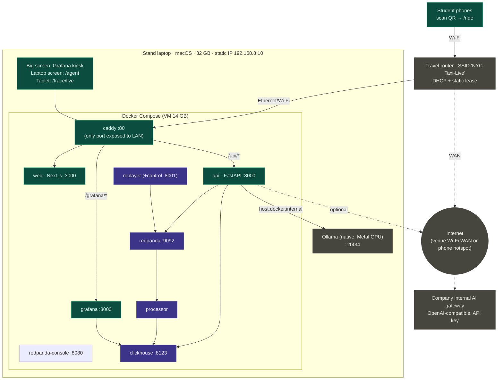

# Spec 09: Infrastructure, Docker Compose & stand networking

## Purpose
Run the whole system reliably on one macOS laptop for a full event day. Make it reachable from students' phones regardless of the venue network, with one command to start it and one to check it.

## Responsibilities
- `docker-compose.yml`: services, healthchecks, dependency order, volumes, and memory limits.
- The `Makefile`, which is the operator interface (CLAUDE.md lists the targets).
- The Caddy edge, which is the single entry point.
- The Ollama host setup, which runs natively outside Compose.
- Stand networking (travel router), macOS preparation, and secrets.

<!-- diagrams:begin -->
## Diagrams
*Copied from [DIAGRAMS.md](../DIAGRAMS.md). Edit there, then run `make diagrams-sync`.*

**§7 Deployment & network**



<!-- diagrams:end -->

## Interfaces
Ports are listed in [ARCHITECTURE §5](../ARCHITECTURE.md#5-ports--services). Only `caddy:80` is reachable from the stand LAN. The deployment diagram is in [DIAGRAMS §7](../DIAGRAMS.md#7-deployment--network).

## Config
All keys are in `.env` (template: [.env.example](../../.env.example)). `make secrets` fills empty password fields with `openssl rand -hex 16`. It never overwrites existing values.

## Behaviour

### Compose services
| Service | Image | Depends on (condition) | Healthcheck | Memory limit | Volumes |
|---|---|---|---|---|---|
| `redpanda` | `redpandadata/redpanda:<pin>` (`redpanda start --mode dev-container --smp 1 --memory 1G --overprovisioned`) | n/a | `rpk cluster health \| grep -q 'Healthy:.*true'` | 1.5 g | `redpanda-data` |
| `redpanda-init` | same image, one-shot `create-topics.sh` | redpanda (healthy) | n/a (exits 0) | n/a | `./infra/redpanda` ro |
| `redpanda-console` | `redpandadata/console:<pin>` | redpanda (healthy) | HTTP `/admin/health` | 256 m | n/a |
| `clickhouse` | `clickhouse/clickhouse-server:<pin LTS>` | redpanda-init (completed) | `wget -qO- localhost:8123/ping` | 4 g | `clickhouse-data`, `./infra/clickhouse/{init,config.d,users.d}` ro, `./data/zones.csv` ro |
| `grafana` | built from `infra/grafana/Dockerfile` (plugin baked in) | clickhouse (healthy) | `wget -qO- localhost:3000/api/health` | 384 m | `./infra/grafana/provisioning` ro, `./data/taxi_zones.geojson` ro |
| `processor` | built from `services/processor` | redpanda-init (completed), clickhouse (healthy) | heartbeat file `/tmp/healthy` touched < 30 s ago | 768 m | `processor-state:/state`, `./data/zones.csv` ro |
| `replayer` | built from `services/replayer` | redpanda-init (completed), processor (healthy) | heartbeat file + `GET :8001/status` | 512 m | `./data/replay` ro, `replayer-state:/data/state` |
| `api` | built from `services/api` | redpanda-init, clickhouse (healthy) | `GET /api/healthz` (checks ClickHouse + broker, **not** the LLM) | 512 m | `./evals` ro |
| `web` | built from `web/` (Next standalone) | api (healthy) | `GET /` | 512 m | n/a |
| `caddy` | `caddy:<pin>` | web, api, grafana (healthy) | n/a | 128 m | `./infra/caddy/Caddyfile` ro |

- All long-running services use `restart: unless-stopped`.
- `api` gets `extra_hosts: ["host.docker.internal:host-gateway"]` to reach native Ollama.
- The ClickHouse official image env: `CLICKHOUSE_USER=admin`, `CLICKHOUSE_PASSWORD=${CLICKHOUSE_ADMIN_PASSWORD}`, `CLICKHOUSE_DEFAULT_ACCESS_MANAGEMENT=1`.
- Python services run `uvicorn` / `python -m` as a non-root user. Logs go to stdout as JSON.

### Backfill
`make backfill UNTIL=<sim ts>` runs these steps:
1. `docker compose stop replayer`
2. `docker compose run --rm -e REPLAY_SPEED=max -e REPLAY_UNTIL_TS=$(UNTIL) replayer`
3. Wait until processor lag on `trips.raw` is 0 (`rpk group describe processor-v1`).
4. `docker compose start replayer`

Live mode continues from the saved state (spec 01).

### Caddy (`infra/caddy/Caddyfile`)
```caddyfile
:80 {
    # Agent SSE and trace WebSockets: never buffer
    handle /api/* {
        reverse_proxy api:8000 {
            flush_interval -1
        }
    }
    # Grafana runs with serve_from_sub_path=true, so keep the /grafana prefix
    handle /grafana/* {
        reverse_proxy grafana:3000
    }
    handle {
        encode zstd gzip
        reverse_proxy web:3000
    }
}
```
- Don't enable `encode` on `/api/*`, because compression can buffer SSE.
- Caddy sets `X-Forwarded-For`. The api runs uvicorn with `--proxy-headers --forwarded-allow-ips=*`, which is safe because only Caddy can reach it.

### Ollama (host, not Compose)
- `brew install ollama`. Pull the chosen model **at home** (it's several GB).
- Run `OLLAMA_HOST=127.0.0.1:11434 OLLAMA_KEEP_ALIVE=-1 OLLAMA_CONTEXT_LENGTH=16384 ollama serve` as a launchd service or in a dedicated terminal.
  - If the pinned Ollama version doesn't support `OLLAMA_CONTEXT_LENGTH`, use the Modelfile route in spec 06.
- Containers reach it at `host.docker.internal:11434`. Ollama binds to loopback only; Docker Desktop's host-gateway reaches loopback on macOS. **Verify this at M0.** If it can't, bind to `0.0.0.0` and rely on the macOS firewall.
- `make preflight` checks both that `curl localhost:11434/v1/models` succeeds and that the model is loaded.

### Stand network
- **Router:** a small travel router (for example a GL.iNet class device).
  - SSID `NYC-Taxi-Live`, WPA2, with a simple password printed on the poster and on `/qr`.
  - DHCP reservation for the laptop's MAC → **192.168.8.10**, which is `STAND_PUBLIC_URL`.
  - Plug the laptop in **by Ethernet** (USB-C adapter) for stability.
- **Uplink** (optional, only needed for the internal AI gateway): the router's repeater mode to venue Wi-Fi, *or* USB tethering from a phone. The demo works with no uplink.
- **macOS firewall:** allow incoming connections for Docker. Test from a phone: `http://192.168.8.10/ride`.
- **Capacity:** travel routers handle about 30–50 clients comfortably. Students only need the connection for the ride form and trace page.
- **Fallbacks** (RUNBOOK): phone hotspot (fewer clients), or a public tunnel if internet is available (the URL changes, so show `/qr` rather than the printed code).

### macOS preparation (stand laptop)
- Power adapter always connected. Battery settings: prevent sleep on power. `caffeinate -dimsu` runs during the event (`make up` starts it, `make down` stops it).
- Do Not Disturb on. Automatic updates off for the event week. Screen saver and auto-lock off.
- Docker Desktop: Memory 14 GB, CPUs 6, disk ≥ 64 GB, start at login.
- Browsers in kiosk mode: `open -na "Google Chrome" --args --kiosk --app=http://localhost/agent`, and similar for Grafana on the external screen.
- Build **all images and pull all dependencies at home**: `make images` (`docker compose build && docker compose pull`). Optionally `docker save` them to an SSD for a backup laptop.

### Secrets
- `.env` is git-ignored. `.env.example` has keys but no values, apart from non-secret defaults.
- The internal AI API key lives only in `.env` → the `api` container env. It is never sent to the browser or logged.
- Passwords are per-user ClickHouse credentials (spec 04). The Grafana admin password comes from `.env`.

## Failure modes
| Failure | Behaviour / recovery |
|---|---|
| A container crashes | `restart: unless-stopped`. Consumers resume from offsets |
| Laptop sleeps | Prevented by caffeinate. If it happens anyway, the replayer re-anchors (spec 01) |
| Router dies | Phone hotspot fallback (RUNBOOK) |
| Docker Desktop hangs | RUNBOOK: quit Docker, `make up`. The volumes persist, so there's no data loss |
| Disk fills | ~5 GB is needed in total. Preflight checks for ≥ 20 GB free |

## Observability
- `make status` prints `docker compose ps`, memory per container (`docker stats --no-stream`), processor lag (`rpk group describe`), freshness, and the LLM status.
- Stand Health dashboard (spec 05).

## Acceptance criteria
1. On a clean clone: `cp .env.example .env && make secrets && make data && make up` results in every service `healthy` within 3 min, with no manual steps.
2. `make down && make up` preserves ClickHouse data and replayer position.
3. From a phone on the stand router, `/ride`, `/trace/…`, `/agent`, and `/grafana/…` all load. `:8123`, `:9092`, and `:8080` are **not** reachable from the phone.
4. SSE through Caddy: the first agent event arrives in < 500 ms with no batching. WebSocket trace works through Caddy.
5. With the router's uplink unplugged, the full demo works with the local model.
6. `docker stats` over the soak shows no container exceeding 90% of its memory limit.

## Out of scope
TLS on the stand LAN (HTTP is fine for a closed network with no credentials), Kubernetes, and remote hosting.
